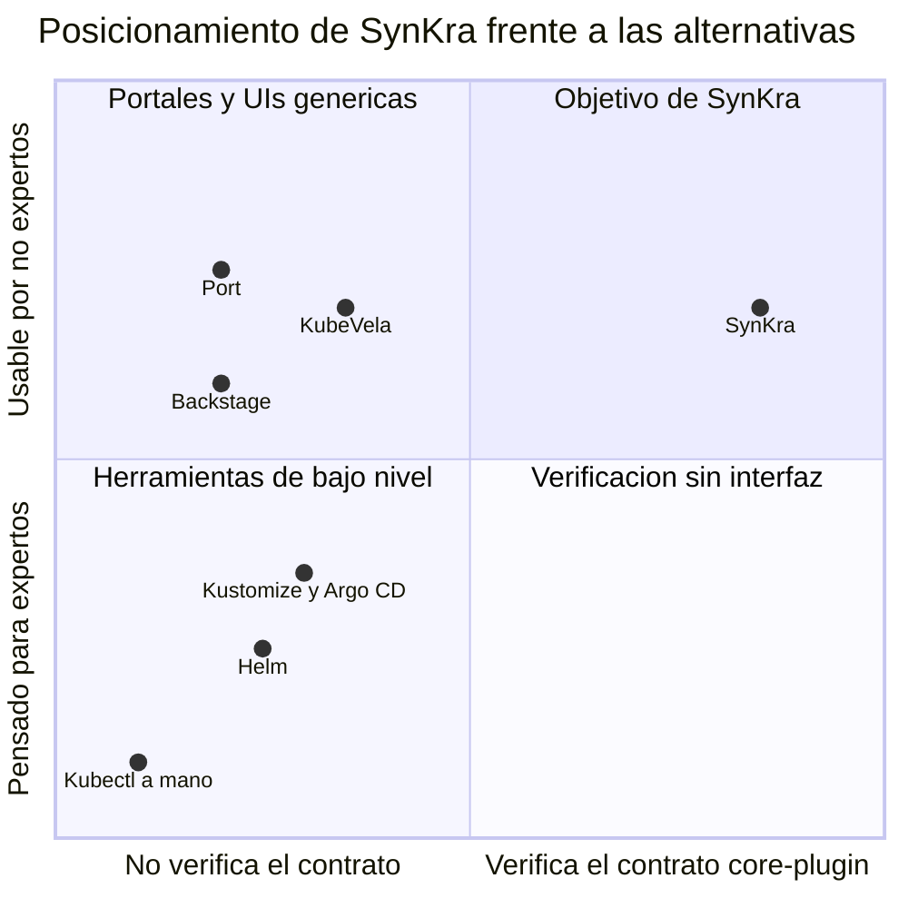

# PRD: SynKra

**Módulo 3 · Tópicos Especiales en Informática · versión 2.0 (en co-creación) · 21 de noviembre de 2026**

> **Insumos:** `../../Modulo 2/pvb.md`, `../docs/overview.md`, `../docs/mercado.md`,
> `../docs/icp.md`, `../docs/critica.md` y las decisiones de `paso-0-conflictos.md`.
> Etiquetas: **[INTERNO]** = proyección propia; **[VERIFICAR]** = afirmación sin fuente primaria
> confirmada. Ningún [VERIFICAR] se usa aquí como hecho.
>
> Reemplaza la versión 1.0 del 17-oct-2026, que especificaba un agente de IA regulatorio (queda
> en el historial de Git). **Este PRD se escribe segmento por segmento y cada uno lo aprueba
> Julian.** Estado de los segmentos: 1 a 7 aprobados; 8 en revisión; 9 a 13 pendientes.

> [!IMPORTANT]
> **Desviación declarada:** SynKra no usa IA (PVB §6). El segmento 11 evalúa la verificación,
> no un modelo.

---

## 1. One-liner y Job to be Done

**One-liner.** SynKra es una herramienta de **despliegue** para aplicaciones micro-kernel ya
compiladas, sobre Kubernetes. Desde un front de acceso, el equipo elige qué core y qué plugins
lleva cada país, y SynKra verifica que la combinación sea compatible y la despliega directo en el
clúster.

**JTBD.** *Cuando* tengo que desplegar mi producto ya compilado en un país, *quiero* elegir desde
un solo lugar qué core y qué plugins lleva, y ver qué corre en cada país, *para* desplegarlo con
la certeza de que la combinación es compatible, sin escribir YAML y sin depender de la persona
que sabe cómo está armado cada país.

**Misión.** Que desplegar el producto en un país nuevo sea elegir un core y sus plugins, no
clonar un repositorio ni escribir manifiestos. Que ninguna combinación incompatible llegue al
clúster. Y, a futuro, que esos despliegues se automaticen.

> [!NOTE]
> **SynKra no compila ni usa Git.** Parte de un proyecto ya compilado: la imagen del core y su
> carpeta de plugins disponibles (`paso-0-conflictos.md`, ajuste posterior).

---

## 2. Contexto y problema

### Dolores del mercado

| Dolor | Evidencia | Fuente |
|---|---|---|
| **Un mismo producto en varios países se mantiene como un núcleo común más diferencias por país** | Oracle FLEXCUBE separa en su instalación los objetos del *kernel* de los del *cluster* de cada país, y Temenos vende "Country Model Banks" | `docs/overview.md` §2 |
| **Mantener cada país como rama o repo propio replica a mano cada cambio del core** | Thoughtworks pone Gitflow en "Hold" por los riesgos de las ramas de larga vida | `docs/overview.md` §3 |
| **Operar el ecosistema de Kubernetes es complejo** | "Too complex to understand or run" es el reto n.º 1 al usar proyectos CNCF en producción (46%, y subió 13% interanual) | CNCF Annual Survey 2024, fig. 15 (`docs/mercado.md` §1) |
| **El freno principal es cultural, no de herramientas** | El reto n.º 1 con contenedores son los cambios culturales con el equipo de desarrollo (46%) | CNCF Annual Survey 2024, fig. 8 |
| **Nadie tiene una vista única de qué corre en cada país** | Hipótesis del ICP: la respuesta vive en la cabeza de una persona o en una hoja de cálculo | `docs/icp.md` **[INTERNO]**, por validar en entrevistas |
| **Desplegar una variante a mano exige YAML y `kubectl` expertos** | Hipótesis del ICP | `docs/icp.md` **[INTERNO]** |

### ¿Por qué ahora?

- **La plataforma interna se volvió un rol estándar.** Gartner predice que "By 2026, 80% of
  large software engineering organizations will establish platform engineering teams", frente al
  45% de 2022 (`docs/overview.md` §5). Ojo: habla de organizaciones **grandes**, no del segmento
  mediano de LatAm.
- **Kubernetes ya es el sustrato común.** Argo CD corre en cerca del 60% de los clústeres
  encuestados (CNCF, 24-jul-2025), lo que indica que desplegar en Kubernetes ya es práctica
  general y no un nicho.
- **Por qué ahora para este proyecto:** la Fase 4 del plan migra los plugins de Colombia y
  Perú al modelo micro-kernel. Sin una herramienta que verifique y despliegue cada combinación,
  esa migración se haría a mano.

> [!WARNING]
> **No hay un evento externo que haga urgente este producto en particular.** La urgencia es
> del segmento (complejidad creciente, equipos de plataforma) y del proyecto (Fase 4). Decirlo
> evita vender una urgencia que los documentos no sostienen.

### Alternativas actuales y por qué no le alcanzan al ICP

| Alternativa | Qué resuelve | Qué le falta para este caso |
|---|---|---|
| **A mano** (YAML + `kubectl`) | Todo, si hay un experto | Depende de una persona; nada impide desplegar una combinación incompatible |
| **Helm** con subcharts opcionales (`condition`, `tags`) | Encender o apagar partes de una aplicación | Los plugins del micro-kernel no son subcharts: viven dentro del compilado. Helm no sabe qué versión del contrato implementa cada plugin |
| **Kustomize components + Argo CD** (GitOps) | Activar componentes por overlay y reconciliarlos desde Git | Exige un flujo de Git que este caso no usa (se parte de artefactos ya compilados). Tampoco verifica el contrato |
| **KubeVela + VelaUX** (CNCF Incubating) | Entrega de aplicaciones por componentes, con una interfaz web para quien no es experto | Modela servicios con OAM, no un core con plugins y un contrato de versiones. Es la alternativa más fuerte |
| **Backstage / Port** | Portal con plantillas o acciones de autoservicio (Port es gratis hasta 5 usuarios) | Hay que construir encima toda la lógica del micro-kernel. Backstage tiene problemas conocidos de adopción (10% de adopción media según Spotify, vía TechTarget) |

> [!IMPORTANT]
> **Qué parte del problema ya está resuelta gratis.** Generar y aplicar los manifiestos de cada
> país ya lo resuelven Kustomize y Helm. Una interfaz web de despliegue para no expertos ya
> existe en parte (VelaUX). **SynKra compite con herramientas gratuitas.** Lo que ninguna
> resuelve como foco es:
>
> 1. verificar, **antes de desplegar**, que los plugins elegidos son compatibles con el contrato
>    del core, y
> 2. mostrar en un solo lugar qué core y qué plugins corren en cada país.
>
> Si ese aporte no le vale a un equipo, la respuesta honesta es que use Kustomize o KubeVela
> (`docs/critica.md` §1 y §8).

---

## 3. ICP detallado

> Hipótesis explícita y falsable (`docs/icp.md`). Nada de este segmento sale de entrevistas
> todavía: todo es **[INTERNO]** hasta validarlo.

### Perfil y firmographics

| Dimensión | Valor |
|---|---|
| **Tamaño del equipo** | Plataforma o entrega de **3 a 15 ingenieros** |
| **Sector** | Vendors de software financiero y fintechs (vertical inicial) |
| **Geografía** | Producto desplegado en **2 o más países**; empieza por Colombia y Perú |
| **Madurez en Kubernetes** | Ya corre Kubernetes en producción. **No se exige GitOps**: SynKra despliega directo |
| **Arquitectura** | Producto **micro-kernel ya compilado**: un core más una carpeta de plugins, o la intención de migrar a ese modelo |

**Señales de calificación:**

1. Hoy cada país es una rama, un repo o un fork, o se despliega a mano con YAML distinto.
2. "Qué tiene activado el país X" se responde preguntándole a una persona.
3. Hay gente de producto o de soporte que necesita desplegar o revisar una variante sin escribir
   YAML.
4. El equipo quiere, a futuro, automatizar esos despliegues.

**Fuera del ICP:** productos de un solo país; equipos sin Kubernetes; equipos que **exigen** que
todo despliegue pase por un PR y GitOps (SynKra no usa Git); y equipos contentos con Helm,
Kustomize, KubeVela o Backstage.

> [!WARNING]
> **Cambio frente a `docs/icp.md`.** La señal "tiene algo de GitOps" se quitó: desde el ajuste
> sin Git del 21-nov, un equipo que exige GitOps queda **fuera** del ICP, no dentro.

### Buyer personas y veto de confianza

| Persona | Rol | Qué le importa | Poder |
|---|---|---|---|
| **Head of Platform / SRE Lead** | Dueño del clúster | "¿Qué permisos de escritura tiene esto en mi clúster?" | **Decisor y veto** |
| **Arquitecto de software** | Dueño del core y del contrato de plugins | Que un plugin no pueda romper el core | **Veto técnico** |
| **Product Owner de país** | Decide qué funciones lleva su país | Desplegar y ver su variante sin depender de un ingeniero | Usuario |
| **Desarrollador de plugins** | Construye y empaqueta un plugin | Un contrato claro y un error legible cuando no cumple | Usuario |

El veto lo tiene el **Head of Platform**: si la cuenta de servicio de SynKra puede escribir fuera
de sus namespaces, la conversación se acaba.

### Pains (de `docs/icp.md`)

- Un cambio del core hay que replicarlo a mano en cada país.
- Nadie tiene una vista única de qué plugin y qué versión corre en cada país.
- Desplegar una variante nueva toma días de YAML y revisiones.

### Triggers de compra

- Se abre un país nuevo y hay que montar su variante.
- Un país se quedó con una versión vieja del core o con un plugin incompatible.
- Rota la persona que sabía cómo estaba armado cada país.

### Objeciones probables y respuesta

| Objeción | Respuesta |
|---|---|
| "Eso ya lo hago con Kustomize o con Helm" | Cierto, y SynKra puede usar Kustomize por debajo. Añade la verificación del contrato antes de desplegar y la vista por país. Si eso no le vale al equipo, no es ICP |
| "¿Por qué no KubeVela?" | KubeVela modela servicios con OAM; SynKra modela un core y sus plugins con un contrato de versiones. La diferencia está por validar en entrevistas **[VERIFICAR]** |
| "Yo despliego con GitOps y reviso PRs" | SynKra no pasa por Git. Para un equipo que exige PRs, hoy no es la herramienta, y se dice así |
| "Es otra pieza con permisos de escritura en mi clúster" | Permisos limitados a `synkra-*`, solo imágenes de un registro permitido y registro de cada despliegue. Se verifica con `kubectl auth can-i` (`docs/critica.md` §5) |

---

## 4. Propuesta de valor única y diferenciadores

### Qué resuelve, para quién y cómo

- **Qué:** desplegar, sin errores de compatibilidad, la variante por país de un producto
  micro-kernel ya compilado, y ver en un solo lugar qué corre en cada país.
- **Para quién:** el ICP del segmento 3. Lo usa el PO de país y lo aprueba el Head of Platform.
- **Cómo:**
  1. El equipo **agrega los compilados a SynKra**: la imagen del core y los artefactos de cada
     plugin. SynKra los registra en su catálogo, con su versión y el contrato que declara cada
     uno.
  2. **Cada core tiene su propia carpeta de plugins, independiente de las demás.** Un plugin se
     sube a la carpeta de un core concreto y se etiqueta por país, región o cliente, y por
     versión.
  3. Desde el front de acceso (Blazor), el usuario elige el core y los plugins de su país.
  4. El motor verifica la combinación **antes** de desplegar y explica por qué una no sirve.
  5. Si pasa, la despliega directo en el namespace del país; el core la vuelve a verificar al
     arrancar.
  6. Cada despliegue queda registrado y se puede volver al anterior.

> [!NOTE]
> **El backend es el producto; el front es demostrativo.** Todo lo que hace el front se puede
> hacer por la API del backend, que en el futuro se usará como mínimo desde una CLI dentro de
> pipelines de automatización. El front en Blazor existe para usos académicos y para demostrar
> la solución.
>
> **SynKra despliega, no versiona código.** Las etiquetas de versión son metadatos para elegir
> qué desplegar, no un control de versiones.

**Propuesta de valor en una línea:** _"Eliges el core y los plugins de tu país en una pantalla, y
nada incompatible llega al clúster."_

### Diferenciación frente a los competidores, incluidos los gratuitos

| Frente a... | Ellos tienen | SynKra añade | Dónde pierde SynKra |
|---|---|---|---|
| Hacerlo a mano | Control total | Verificación del contrato y una vista por país | Flexibilidad: solo despliega lo que cumple el contrato |
| Helm / Kustomize (gratis) | Generar manifiestos por variante | Sabe qué versión del contrato implementa cada plugin | Madurez y ecosistema; de hecho, SynKra puede usar Kustomize por debajo |
| Argo CD (gratis) | GitOps: revisión e historial en Git | Despliega artefactos compilados sin un flujo de Git | **Revisión e historial:** SynKra tiene que construir su propio registro |
| KubeVela + VelaUX (gratis, CNCF) | Componentes, interfaz web para no expertos y adopción en producción | Un modelo de core + plugins con contrato versionado | Casi todo lo demás: comunidad, funciones, madurez |
| Backstage / Port | Portal y autoservicio (Port gratis hasta 5 usuarios) | La lógica del micro-kernel ya hecha | Catálogo, plugins y ecosistema del portal |

### Qué brecha real llena

Ninguna de las alternativas verificadas tiene como foco **verificar el contrato entre un core y
sus plugins antes de desplegar**. Es una brecha **estrecha**: la crítica la considera defendible
como proyecto académico y como capa delgada, no como producto comercial (`docs/critica.md` §8).

### Matriz de posicionamiento

Ubicación de cada actor según juicio propio **[INTERNO]**, a partir de `docs/mercado.md`.

_Texto alternativo:_ en el eje horizontal, cuánto verifica cada herramienta el contrato entre
el core y los plugins; en el vertical, qué tan usable es para quien no es experto. SynKra queda
arriba a la derecha (verifica y es usable). KubeVela, Port y Backstage están arriba a la
izquierda (usables, pero sin verificación del contrato). Helm, Kustomize con Argo CD y `kubectl`
quedan abajo a la izquierda.

> [!WARNING]
> **Trade-off de este posicionamiento.** El eje horizontal lo elegí yo y favorece a SynKra por
> construcción. Con otros ejes (madurez, comunidad, integración con GitOps), KubeVela y Argo CD
> quedan por delante. La matriz muestra **dónde** apunta SynKra, no que gane.

---

## 5. Casos de uso (top 5)

> Los targets de los KPI son **[INTERNO]** y se definen en el segmento 10. Cada caso se puede
> ejecutar desde el front (uso demostrativo) o por la API del backend (uso real y, a futuro,
> CLI en pipelines).

### CU1. Agregar compilados al catálogo

- **Actor:** desarrollador de plugins o responsable de release.
- **Trigger:** hay una versión nueva compilada del core o de un plugin.
- **Flujo:**
  1. Sube el artefacto: un core nuevo (que estrena su propia carpeta de plugins, vacía) o un
     plugin **dentro de la carpeta de un core concreto**.
  2. SynKra lee su descriptor: nombre, versión y versión del contrato que implementa o exige.
  3. Le asigna etiquetas: país, región o cliente que lo usa, y la etiqueta de versión.
  4. Verifica la integridad del artefacto (hash), que el descriptor esté completo y que el
     plugin sea compatible con el contrato de **su** core.
- **Resultado:** el compilado aparece como disponible en la carpeta de su core, o se rechaza
  con un motivo legible. Un plugin de la carpeta del core A no aparece para el core B.
- **KPI:** % de compilados con descriptor inválido rechazados al subirlos.

### CU2. Desplegar un país nuevo

- **Actor:** Product Owner de país.
- **Trigger:** se abre un país y hay que montar su variante.
- **Flujo:**
  1. Entra al front y crea el despliegue del país (por ejemplo, `pe`).
  2. Elige la versión del core y, de la carpeta de ese core, los plugins compatibles,
     filtrando por etiqueta (por ejemplo, `pais=pe`).
  3. SynKra verifica la combinación y muestra un resumen de lo que va a desplegar.
  4. Confirma, y SynKra despliega en `synkra-pe`.
  5. Ve el estado en el front hasta que los pods están listos.
- **Resultado:** el país corre con su core y sus plugins.
- **KPI:** tiempo para desplegar un país nuevo; North Star.

### CU3. Cambiar los plugins de un país que ya existe

- **Actor:** Product Owner de país.
- **Trigger:** el país necesita una función nueva o retirar una.
- **Flujo:**
  1. Abre el despliegue del país y ve qué core y qué plugins corre hoy.
  2. Añade o quita plugins.
  3. SynKra verifica la nueva combinación y muestra qué cambia frente a la actual.
  4. Confirma, y SynKra despliega el cambio.
- **Resultado:** el país corre con la combinación nueva, y la anterior queda en el registro.
- **KPI:** North Star; adopción (% de cambios hechos desde SynKra).

### CU4. Rechazar una combinación incompatible

- **Actor:** Product Owner de país o desarrollador de plugins.
- **Trigger:** se elige un plugin que no cumple el contrato del core (por ejemplo, `kyc-pe` 2.x
  exige el contrato 3 y el core implementa el 2).
- **Flujo:**
  1. El usuario elige el plugin.
  2. El motor marca la incompatibilidad **antes** de desplegar.
  3. El front explica el motivo y qué versión del core o del plugin sí sirve.
- **Resultado:** nada se despliega; el usuario sabe qué corregir.
- **KPI:** % de combinaciones inválidas detectadas antes de desplegar (meta: 100%).

### CU5. Ver qué corre en cada país y volver al despliegue anterior

- **Actor:** Head of Platform o SRE.
- **Trigger:** un despliegue nuevo falla, o alguien pregunta qué tiene un país.
- **Flujo:**
  1. Abre la vista general: cada país con su core, sus plugins y su estado, leídos del clúster.
  2. Abre el registro del país: quién desplegó qué y cuándo.
  3. Elige el despliegue anterior y confirma la vuelta atrás.
  4. SynKra lo vuelve a desplegar y registra la reversión.
- **Resultado:** el país vuelve a una combinación conocida y queda la traza.
- **KPI:** tiempo para volver al despliegue anterior; concordancia entre el registro y el clúster.

---

## 6. Principios de diseño no negociables

> SynKra no tiene un agente de IA, pero **sí actúa sobre infraestructura**: despliega en el
> clúster. Por eso el principio P2 es su límite de autonomía, expresado de forma verificable.

| Principio | (a) Operativamente | (b) En el producto | (c) Prohibido, y cómo se verifica |
|---|---|---|---|
| **P1. Nada incompatible llega al clúster** | Doble verificación del contrato: el motor antes de desplegar y el core al arrancar, con la misma regla | Una sola librería de verificación, compartida por el backend y el core | Desplegar una combinación que el motor no aprobó. **Verificación:** la suite del segmento 11 pasa al 100%, y un core con un plugin incompatible en su carpeta no arranca |
| **P2. Límite de autonomía verificable** | SynKra solo despliega cuando un humano lo confirma (en el front o con un comando explícito de la API o la CLI), y solo en sus namespaces | Cuenta de servicio `synkra:deployer` con RBAC limitado a `synkra-*`; solo imágenes de un registro permitido | Desplegar sin confirmación o fuera de `synkra-*`. **Verificación:** `kubectl auth can-i create deployments -n default --as=system:serviceaccount:synkra:deployer` responde `no` |
| **P3. El core no conoce países** | La variación vive en los plugins y en sus etiquetas; el core solo define puntos de extensión | Etiquetas de país, región o cliente en los plugins, no en el core | Lógica del tipo "si país == CO" en el core. **Verificación:** `grep -rniE "colombia\|peru" core/src` sin resultados |
| **P4. Cada core tiene su carpeta de plugins, independiente** | Un plugin pertenece a la carpeta de un solo core | El catálogo agrupa plugins por core | Que un plugin del core A aparezca o se despliegue con el core B. **Verificación:** prueba de API que lo intenta y recibe un rechazo |
| **P5. El backend primero** | Toda acción del front existe en la API; el front no tiene lógica propia | API documentada (OpenAPI); el front en Blazor solo la consume; la CLI futura usará la misma API | Lógica de negocio en el front. **Verificación:** los 5 casos de uso se ejecutan de punta a punta con `curl`, sin el front |
| **P6. Despliegue, no código** | SynKra parte de artefactos ya compilados; las versiones son etiquetas | Catálogo de compilados con etiquetas | Compilar, guardar código fuente, integrarse con Git o hacer control de versiones de código |
| **P7. Todo despliegue es trazable y reversible** | Cada despliegue queda registrado (quién, cuándo, core, plugins y versiones) y se puede revertir | Registro de despliegues y botón o comando de volver al anterior | Un despliegue sin registro. **Verificación:** el registro coincide con lo que corre en el clúster (métrica de concordancia, segmento 10) |
| **P8. Sin IA** | Ninguna función depende de un modelo (desviación declarada, PVB §6) | Verificación determinista | Añadir una IA decorativa para cumplir el requisito del curso |

> [!CAUTION]
> **Trade-off aceptado (P2 + P6).** Al no pasar por Git, ningún humano revisa un despliegue
> antes de que se aplique, más allá de quien lo confirma. P1, P2 y P7 son la compensación, y por
> eso son Must y no extras.

---

## 7. User journeys

### 7.1 Happy path del usuario final: Lucía, PO de Perú, despliega su país

1. Lucía entra al front de SynKra con su usuario.
2. En la vista general ve los países que ya corren. Perú todavía no está.
3. Crea el despliegue `pe` y elige el core `synkra-core 2.1`. El front le muestra **solo** la
   carpeta de plugins de ese core.
4. Filtra por la etiqueta `pais=pe` y elige `kyc-pe 1.3` y `consentimiento-pe 1.0`.
5. Mientras elige, el motor verifica: los dos plugins implementan el contrato 2, igual que el
   core. Todo en verde.
6. El front le muestra el resumen: core, plugins, versiones y namespace `synkra-pe`.
7. Confirma. SynKra despliega y muestra el avance hasta que los pods están listos.
8. Al arrancar, el core detecta los dos plugins en su carpeta, los verifica y los activa.
9. En la vista general, Perú aparece con su core y sus dos plugins. El registro anota quién,
   cuándo y qué se desplegó.

### 7.2 Happy path del operador: Andrés, Head of Platform, prepara SynKra

1. Andrés instala SynKra en el clúster (`kind` en el demo) con un solo comando.
2. La instalación crea la cuenta de servicio `synkra:deployer`, con permisos solo en `synkra-*`,
   y configura el registro de imágenes permitido.
3. Verifica el límite: `kubectl auth can-i create deployments -n default
   --as=system:serviceaccount:synkra:deployer` responde `no`.
4. Por la API (sin el front), sube el core `synkra-core 2.1`. SynKra crea su carpeta de plugins
   vacía.
5. Sube los plugins `kyc-co`, `kyc-pe` y `consentimiento-pe` a esa carpeta, con sus etiquetas
   de país y versión.
6. Consulta el catálogo por la API y confirma que los tres plugins quedaron en la carpeta
   correcta y como compatibles.

### 7.3 Edge case: Lucía abandona a mitad del flujo

1. Lucía elige el core y un plugin, pero cierra el navegador antes de confirmar.
2. **No se despliega nada**: SynKra solo despliega con una confirmación explícita (P2).
3. La selección a medias no queda en el registro de despliegues, porque no hubo despliegue.
4. Cuando Lucía vuelve, la vista general muestra a Perú sin desplegar y ella empieza de nuevo.
   Guardar borradores de selección queda como Could (segmento 8).

### 7.4 Edge case: SynKra no puede resolver y escala a un humano

**Situación:** el motor aprobó la combinación, pero el pod del core no arranca. Por ejemplo, el
plugin `kyc-pe 1.3` falla en su inicialización por un error propio que el contrato no detecta.

1. SynKra despliega y espera a que los pods estén listos.
2. El core arranca, carga `kyc-pe` y el plugin lanza un error. El pod entra en reinicios.
3. Al vencer el tiempo de espera, SynKra marca el despliegue como **fallido**.
   **No reintenta ni revierte por su cuenta**: cambiar el clúster requiere confirmación (P2).
4. El front y la API muestran el estado "fallido" y la opción de volver al despliegue anterior.
5. **Traspaso al humano.** SynKra deja en el registro de ese despliegue el contexto para el SRE:
   - la combinación desplegada (core, plugins, versiones y etiquetas);
   - el resultado de la verificación del motor (aprobada, y con qué regla);
   - el log de arranque del core y el motivo del error del plugin;
   - los eventos de Kubernetes del pod;
   - quién confirmó el despliegue y cuándo.
6. El SRE revisa el contexto, confirma la vuelta al despliegue anterior y avisa al dueño del
   plugin.
7. Si se trató de una discrepancia entre el motor y el core, se cuenta en la métrica de
   concordancia (segmento 10) y se añade el caso a la suite del segmento 11.

---

## 8. Alcance del MVP (MoSCoW)

> **Restricción real.** La sustentación es la semana siguiente al 21-nov-2026 **[VERIFICAR
> fecha exacta]**. El MVP tiene que correr de punta a punta en `kind`; todo lo que no sea
> indispensable para la demo queda en Should o más abajo (`docs/critica.md` §6).

| Prioridad | Ítem | Por qué |
|---|---|---|
| **Must** | **Core** en Java 21 / Spring Boot con un contrato de plugins versionado, que al arrancar lee su carpeta de plugins, los verifica y activa los que pide el despliegue | Es el micro-kernel (PVB §3) |
| **Must** | **Dos plugins de país**, `kyc-co` y `kyc-pe`, con reglas simuladas | Demuestran la variación por país (`docs/overview.md` §6) |
| **Must** | **Backend de SynKra** con API REST: catálogo de compilados, una carpeta de plugins independiente por core, etiquetas (país, región o cliente, y versión), verificación, despliegue, registro y vuelta atrás | El backend es el producto (P5) |
| **Must** | **Motor de verificación** en una librería compartida por el backend y el core | P1: nada incompatible llega al clúster |
| **Must** | **Despliegue directo** en `kind`, un namespace por país, con la cuenta de servicio `synkra:deployer` limitada a `synkra-*` | P2: límite de autonomía verificable |
| **Must** | **Registro de despliegues y vuelta al anterior** | P7: compensa la falta de Git |
| **Must** | **Front en Blazor**, demostrativo, que cubre los 5 casos de uso consumiendo solo la API | Uso académico y demo (segmento 4) |
| **Must** | Imágenes multi-stage, mínimas y con usuario no root | Módulo 3 del curso |
| **Should** | Autenticación sencilla en el front y en la API | Riesgo 3 del PVB: SynKra tiene permisos de escritura |
| **Should** | Solo imágenes de un registro permitido (política de admisión o validación en el backend) | Riesgo 3 del PVB |
| **Should** | NetworkPolicy *deny-by-default*, Pod Security `restricted` y límites de recursos por pod | Módulos 1 y 7 del curso |
| **Should** | `compose.yaml` de desarrollo con las 6 prácticas del módulo 3 y escaneo con Trivy | Módulo 3 del curso |
| **Should** | API documentada con OpenAPI | Base para la CLI futura |
| **Could** | **CLI mínima** sobre la API (`synkra deploy`, `synkra status`) | Visión de automatización en pipelines |
| **Could** | Guardar borradores de una selección | Journey 7.3 |
| **Could** | Dependencias entre plugins | Paso 0, conflicto 5 |
| **Could** | Métricas en Prometheus | Módulo 8 |
| **Won't** | Git, GitOps, PRs o Argo CD en el flujo | Decisión del 21-nov: SynKra solo despliega |
| **Won't** | Compilar, guardar código fuente o versionar código | P6: despliegue, no código |
| **Won't** | IA | Desviación declarada (P8) |
| **Won't** | Multi-tenant, varios clústeres o marketplace de plugins | Fuera de tiempo (Paso 0, conflicto 8) |
| **Won't** | Automatizar despliegues sin un humano | Visión a futuro; en el MVP todo despliegue requiere confirmación (P2) |

> [!WARNING]
> **Decisión abierta para el segmento 9:** cómo llega la carpeta de plugins de un core al pod
> (un volumen que SynKra llena antes del arranque, un init container que la descarga del
> catálogo, u otra vía). Afecta al motor de despliegue, pero no al alcance.

---

## 9. Especificación funcional: módulos y features

_Pendiente._
