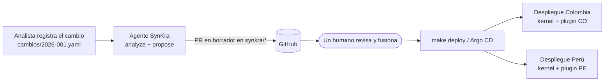
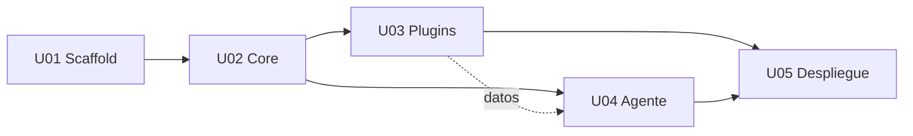

# SynKra

**Plataforma micro-kernel que despliega el mismo producto en cada país con solo los plugins que
ese país necesita, y un agente de IA que encuentra dónde aplicar cada cambio regulatorio, sobre
Kubernetes.**

Proyecto de la asignatura **Tópicos Especiales en Informática** · Maestría en Ingeniería de
Sistemas · Pontificia Universidad Javeriana (Bogotá), 2026-3.

> **Estado actual:** especificación terminada (módulos 2, 3 y 5). El código se construye en el
> módulo 6 con el loop de agentes, siguiendo `unidades-y-tareas.md`. Más abajo se indica qué se
> puede probar hoy y qué se podrá probar cuando el código exista.

---

## 1. La idea

Una empresa que vende el mismo producto en varios países tiene que respetar reglas distintas en
cada uno: qué documento de identidad se valida, qué pide la ley de protección de datos, cuánto
tiempo se guardan los datos. Lo habitual es copiar el código por país, y cada cambio de ley hay
que aplicarlo a mano en cada copia; tarde o temprano un país se queda sin el cambio.

SynKra lo resuelve en dos partes:

1. **Un kernel común con plugins por país.** El kernel no sabe nada de países: define tres
   "enchufes" (puntos de extensión) y cada país aporta un plugin que los llena. Cada país se
   despliega en Kubernetes con su propio plugin.
2. **Un agente de IA que propone, pero no decide.** Cuando una persona registra un cambio
   regulatorio ya interpretado, el agente encuentra qué plugin hay que modificar y abre un
   *pull request* en borrador. Nunca fusiona ni despliega: eso lo aprueba siempre un humano.



| Pieza | Qué hace |
|---|---|
| **Kernel** (`core/`) | Carga los plugins, expone la API KYC y no contiene lógica de ningún país |
| **Plugins** (`plugins/co`, `plugins/pe`) | Reglas de Colombia y Perú: validar documento, consentimiento de datos y retención |
| **Agente** (`agent/`) | CLI `synkra`: `analyze` encuentra el plugin y escribe un informe; `propose` abre el PR en borrador |
| **IA** | Claude (modelo Haiku) con tope de gasto, o modo `fake` sin llamadas a la API |
| **Despliegue** (`deploy/`) | Imágenes de contenedor, un overlay de Kustomize por país, seguridad del clúster y Argo CD |

---

## 2. Requerimientos

El detalle está en [`aidlc-docs/inception/requirements/requirements.md`](aidlc-docs/inception/requirements/requirements.md)
(39 requisitos funcionales y 12 no funcionales) y en 37 historias de usuario
([`stories.md`](aidlc-docs/inception/user-stories/stories.md)). Lo esencial:

**Funcionales**
- El kernel define tres puntos de extensión: validación de documento, política de consentimiento
  y política de retención.
- Cada despliegue atiende un solo país. La API responde por `/kyc/{país}/...` y devuelve 404 si
  el país no es el del despliegue.
- Plugins de Colombia (cédula) y Perú (DNI). Las reglas son simuladas y van marcadas `verificar`
  hasta contrastarlas con la ley.
- `synkra analyze <cambio>` decide con reglas fijas qué plugin se ve afectado; la IA solo redacta
  el texto del informe.
- `synkra propose <id>` crea la rama `synkra/<id>` y abre un PR en borrador con una solicitud de
  cambio dentro del plugin. No modifica código.
- Evaluación con 20 cambios de prueba y pruebas de inyección de instrucciones.

**No funcionales y límites del agente** (reglas bloqueantes en
`.aidlc-rule-details/extensions/autonomia/limite/`)
- **AUTONOMIA-01:** el agente nunca fusiona, aprueba, escribe en `main` ni aplica nada al clúster.
- **AUTONOMIA-02:** gasto de IA acotado: 5.000 tokens al día y 300 por llamada; las pruebas usan
  siempre `LLM_PROVIDER=fake`.
- **AUTONOMIA-03:** cada tarea se verifica con un comando, no con una opinión.
- Todo corre en Linux; en Windows, dentro de WSL2.

---

## 3. Unidades y tareas

La especificación se hizo con el marco **AI-DLC v1.0.1** de AWS: requisitos → historias →
diseño → unidades → plan de tareas por unidad, con aprobación humana en cada etapa (bitácora en
[`aidlc-docs/audit.md`](aidlc-docs/audit.md)). El resultado son **5 unidades y 91 tareas**,
consolidadas en [`unidades-y-tareas.md`](unidades-y-tareas.md).

| Unidad | Tareas | Qué construye |
|---|---|---|
| **U01 Scaffold** | 10 | Estructura del proyecto: `pom.xml` raíz (Java 21, `com.synkra`), módulos, `make build` y `make test`, `.gitignore` y README |
| **U02 Core** | 16 | El kernel: los tres puntos de extensión, el lector del manifiesto `plugin.yaml`, la carga de plugins, la API KYC, `/plugins` y health |
| **U03 Plugins** | 16 | Plugins de Colombia y Perú: validación de formato de cédula y DNI, campos de consentimiento, retención de 5 años |
| **U04 Agente** | 28 | CLI `synkra` (`analyze`, `propose`), conector a Claude con tope de gasto y modo `fake`, lista blanca de comandos `git`/`gh`, evaluación y red-teaming, protección de `main` |
| **U05 Despliegue** | 21 | Imagen distroless del kernel, imagen con los plugins, overlays `co` y `pe`, `make deploy`, Pod Security, NetworkPolicy, Argo CD y el Job del agente |

**Cómo están definidas.** Cada tarea tiene un identificador (`U02-T05`), la historia que
implementa y un comando de aceptación; por ejemplo, la tarea termina cuando
`mvn -q -pl core compile` sale en `0`. Las tareas marcadas **[PERSONA]** las hace un humano porque
tocan GitHub o el clúster.

**Orden de construcción:**



U03 y U04 se construyen **en paralelo**. Las decisiones de diseño están en
[`DECISIONES.md`](DECISIONES.md).

---

## 4. Instalación

Todo se ejecuta en Linux. En Windows se usa **WSL2 con Ubuntu**, de modo que los dos sistemas
corren exactamente los mismos scripts.

**Requisitos:** 8 GB de RAM libres (6 como mínimo), unos 15 GB de disco y conexión a internet.

### Linux (Ubuntu o Debian)

```bash
git clone https://github.com/Jacarrilloc/SynKra.git ~/proyectos/SynKra
cd ~/proyectos/SynKra
make setup      # instala Docker, kubectl 1.37, kind 0.33, Helm, jq, Java 21, Maven, Node y Claude Code
```

Si el script te agrega al grupo `docker`, cierra la sesión y vuelve a entrar.

### Windows 10/11

1. Si no tienes WSL, en PowerShell **como administrador**: `wsl --install -d Ubuntu-24.04` y
   reinicia.
2. En PowerShell normal, desde la carpeta del repositorio:
   ```powershell
   .\scripts\setup-windows.ps1
   ```
   Clona el repositorio en `~/proyectos/SynKra` **dentro de Ubuntu** e instala todo allí. Te pide
   la contraseña de Ubuntu (`sudo`).
3. Si te agregó al grupo `docker`: `wsl --shutdown` y vuelve a abrir.
4. Para trabajar desde ese momento:
   ```powershell
   wsl -d Ubuntu
   cd ~/proyectos/SynKra
   ```

> Trabaja siempre en `~/proyectos/SynKra` (disco de Linux), no en `/mnt/c/...`: el disco de
> Windows vuelve lentos a Docker y a `git worktree`.

---

## 5. Configuración

| Qué | Cómo | Para qué |
|---|---|---|
| Proveedor de IA | `export LLM_PROVIDER=fake` (por defecto) o `claude` | `fake` no llama a la API y no cuesta nada |
| Clave de Claude | Guarda la clave en un archivo y `export ANTHROPIC_API_KEY_FILE=~/.synkra/anthropic.key` | Solo si usas `claude`. Nunca la pongas en el repositorio |
| Tope de gasto | Por defecto 5.000 tokens al día y 300 por llamada | Además, fija un límite mensual en la consola de Anthropic (*Settings → Limits*) |
| Token del agente en GitHub | `export AGENT_TOKEN_FILE=~/.synkra/github.token` | Para `propose`. Tarea U04-T02 |
| País del despliegue | `make deploy COUNTRY=co` o `COUNTRY=pe` | Elige qué overlay y qué plugin se despliegan |

La protección de `main` y la identidad del agente en GitHub las configura una persona con
`scripts/configure-github.sh` (tareas U04-T01 y U04-T02).

---

## 6. Ejecución

| Comando | Qué hace | Disponible |
|---|---|---|
| `make help` | Lista los comandos | Ya |
| `make doctor` | Verifica herramientas y Docker | Ya |
| `make cluster` | Crea un clúster Kubernetes local con kind y espera a que esté `Ready` | Ya |
| `make status` | Muestra nodos y pods | Ya |
| `make cluster-delete` | Borra el clúster | Ya |
| `make build` / `make test` | Compila y corre las pruebas (con `LLM_PROVIDER=fake`) | Tras U01 |
| `make images` | Construye las imágenes del kernel y de los plugins | Tras U05 |
| `make deploy COUNTRY=co` | Despliega Colombia en el clúster | Tras U05 |
| `synkra analyze` / `synkra propose` | El agente | Tras U04 |

---

## 7. Cómo probarlo

### 7.1 Lo que se puede probar hoy: el entorno

```bash
make doctor          # todo debe salir [ok]
make cluster         # crea el clúster
make status          # el nodo synkra-control-plane debe estar Ready
make cluster-delete
```

Resultado esperado de `make doctor`: git, docker, kubectl v1.37.0, kind v0.33.0, helm, jq, make,
java 21, mvn, node y claude en `[ok]`, y "Docker daemon: responde".

### 7.2 Cómo debería funcionar: demostración completa

Esta es la prueba de punta a punta que define el PRD. Cada paso queda disponible cuando su unidad
esté construida.

**1. Desplegar dos países** (U05)
```bash
make cluster
make images
make deploy COUNTRY=co
make deploy COUNTRY=pe
kubectl get pods -n synkra-co                   # un pod Running
kubectl get pods -n synkra-pe                   # un pod Running
scripts/verify-countries.sh                     # comprueba los dos países de una vez
```

**2. Usar la API de un país** (U02 y U03)
```bash
kubectl port-forward -n synkra-pe deploy/<nombre-del-kernel> 8080:8080 &   # el nombre lo fija U05
curl localhost:8080/plugins                     # lista solo el plugin pe
curl -X POST localhost:8080/kyc/pe/document/validate \
     -H 'Content-Type: application/json' -d '{"type":"DNI","number":"12345678"}'   # 200, válido
curl -X POST localhost:8080/kyc/co/document/validate \
     -H 'Content-Type: application/json' -d '{"type":"CC","number":"123"}'         # 404: este despliegue es de Perú
curl localhost:8080/kyc/pe/consent              # campos de consentimiento exigidos
curl localhost:8080/kyc/pe/retention            # 5 años por categoría (valor provisional)
```

**3. Registrar un cambio regulatorio y que el agente lo ubique** (U04)
```bash
cat > cambios/2026-001.yaml <<'EOF'
country: pe
topic: consent
text: El consentimiento debe incluir la finalidad del tratamiento.
reference: Circular de ejemplo 1 de 2026
EOF
LLM_PROVIDER=fake synkra analyze cambios/2026-001.yaml
cat informes/2026-001.md        # afectado: plugins/pe (ConsentPolicy); descartado: plugins/co, con el motivo
```

**4. Que el agente proponga, y que un humano decida** (U04)
```bash
synkra propose 2026-001         # crea synkra/2026-001 y abre un PR en borrador
gh pr view synkra/2026-001      # el PR solo agrega plugins/pe/changes/2026-001.md
```

**5. Comprobar los límites del agente** (U04 y U05)
```bash
gh api repos/Jacarrilloc/SynKra/branches/main/protection \
   --jq .required_pull_request_reviews.required_approving_review_count   # >= 1
kubectl auth can-i create deployments \
   --as=system:serviceaccount:synkra:agent -n synkra                     # no
```

**6. Comprobar el tope de gasto sin costo** (U04)
```bash
make test                       # toda la suite corre con LLM_PROVIDER=fake
```
Con el presupuesto en 0, `synkra analyze` responde "presupuesto agotado" y no llama a la API.

---

## 8. Estructura del repositorio

```
Modulo 2/pvb.md                 Product Vision Board
Modulo 3/docs/                  Investigación: dominio, mercado, ICP y crítica
Modulo 3/specs/prd.md           PRD
entradas/                       Copia de los insumos que leyó AI-DLC
aidlc-docs/                     Requisitos, historias, diseño, unidades, planes y bitácora
.aidlc-rule-details/            Reglas de AI-DLC y la regla de autonomía del agente
CLAUDE.md                       Despachador de AI-DLC (se carga en cada sesión de Claude Code)
unidades-y-tareas.md            Las 5 unidades y sus 91 tareas
DECISIONES.md                   Decisiones del módulo 5
scripts/, Makefile              Instalación y comandos para Linux y WSL2
```
