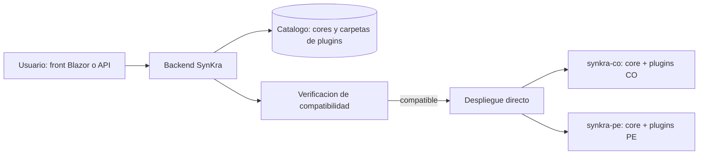

# SynKra

**Herramienta de despliegue para aplicaciones micro-kernel ya compiladas sobre Kubernetes: eliges
el core y los plugins de cada país, y SynKra verifica que sean compatibles antes de desplegarlos.**

Proyecto de la asignatura **Tópicos Especiales en Informática** · Maestría en Ingeniería de
Sistemas · Pontificia Universidad Javeriana (Bogotá), 2026-3. Es un **ejercicio académico**.

---

## 1. La idea

Un mismo producto desplegado en varios países se compone de un **core** común más **plugins**
con lo que cambia en cada país. SynKra parte de ese producto **ya compilado**:

1. Se suben a SynKra los compilados: un core, que estrena **su propia carpeta de plugins**, y los
   plugins de esa carpeta. Cada plugin lleva etiquetas de país, región o cliente, y **dos
   etiquetas de versión**: la del plugin y la del core compatible.
2. Desde un front de acceso se elige, para cada país, el core y sus plugins.
3. SynKra **verifica la compatibilidad antes de desplegar** y explica por qué una combinación no
   sirve.
4. Si pasa, la **despliega directo** en el namespace del país, sin Git de por medio. El core
   vuelve a verificar sus plugins al arrancar.
5. Cada despliegue queda registrado y se puede volver al anterior.



| Pieza | Qué hace |
|---|---|
| **Backend** (Java 21 / Spring Boot) | API REST: catálogo, verificación, despliegue, registro y vuelta atrás. A futuro, también una CLI para pipelines |
| **Front** (Blazor) | Acceso visual, solo para uso académico y demostrativo. Consume la API |
| **Core y plugins** | El producto que se despliega. El core lee `/plugins` al arrancar y verifica cada plugin |
| **Persistencia** | SQLite, en el mismo volumen que los artefactos |
| **SynKra mismo** | Se instala con GitOps (módulo 8 del curso) |

No hay IA (desviación declarada frente al curso) ni Git en el flujo de despliegue.

---

## 2. Requerimientos

El PRD completo está en [`Modulo 3/specs/prd.md`](Modulo%203/specs/prd.md): 13 segmentos
aprobados uno por uno. La visión está en [`Modulo 2/pvb.md`](Modulo%202/pvb.md) y la
investigación en [`Modulo 3/docs/`](Modulo%203/docs/). Lo esencial:

- **Nada incompatible llega al clúster:** doble verificación, en el backend antes de desplegar y
  en el core al arrancar, con la misma librería.
- **Límite de autonomía verificable:** SynKra solo despliega con confirmación y solo en
  `synkra-*`.
- **Cada core tiene su carpeta de plugins independiente.**
- **Backend primero:** todo lo que hace el front se puede hacer por la API.
- **Despliegue, no código:** SynKra no compila ni versiona código.
- **Todo despliegue es trazable y reversible.**

---

## 3. Unidades y tareas

Se definieron en el módulo 5 con AI-DLC, a partir del PRD v2: 11 unidades (9 Must, 2 Should) y
114 tareas, cada una con su criterio por comando. Están consolidadas en
[`unidades-y-tareas.md`](unidades-y-tareas.md), y las decisiones del paso, en
[`DECISIONES.md`](DECISIONES.md).

---

## 4. Instalación

Todo se ejecuta en Linux. En Windows se usa **WSL2 con Ubuntu**, de modo que los dos sistemas
corren exactamente los mismos scripts.

**Requisitos:** 8 GB de RAM libres (6 como mínimo), unos 15 GB de disco y conexión a internet.

### Linux (Ubuntu o Debian)

```bash
git clone https://github.com/Jacarrilloc/SynKra.git ~/proyectos/SynKra
cd ~/proyectos/SynKra
make setup      # instala Docker, kubectl 1.37, kind 0.33, Helm, jq, Java 21, Maven, Node y Claude Code
```

Si el script te agrega al grupo `docker`, cierra la sesión y vuelve a entrar.

### Windows 10/11

1. Si no tienes WSL, en PowerShell **como administrador**: `wsl --install -d Ubuntu-24.04` y
   reinicia.
2. En PowerShell normal, desde la carpeta del repositorio:
   ```powershell
   .\scripts\setup-windows.ps1
   ```
   Clona el repositorio en `~/proyectos/SynKra` **dentro de Ubuntu** e instala todo allí. Te pide
   la contraseña de Ubuntu (`sudo`).
3. Si te agregó al grupo `docker`: `wsl --shutdown` y vuelve a abrir.
4. Para trabajar desde ese momento:
   ```powershell
   wsl -d Ubuntu
   cd ~/proyectos/SynKra
   ```

> Trabaja siempre en `~/proyectos/SynKra` (disco de Linux), no en `/mnt/c/...`: el disco de
> Windows vuelve lentos a Docker y a `git worktree`.

---

## 5. Configuración

Se define durante la construcción. Lo previsto: la cuenta de servicio `synkra:deployer` con
permisos solo en `synkra-*`, el registro de imágenes permitido y el volumen del backend.

---

## 6. Ejecución

| Comando | Qué hace | Disponible |
|---|---|---|
| `make help` | Lista los comandos | OK |
| `make doctor` | Verifica herramientas y Docker | OK |
| `make cluster` | Crea un clúster Kubernetes local con kind y espera a que esté `Ready` | OK |
| `make status` | Muestra nodos y pods | OK |
| `make cluster-delete` | Borra el clúster | OK |
| Build, pruebas, instalación de SynKra | Se definen por unidad en la construcción | Pendiente |

---

## 7. Cómo probarlo

### 7.1 Lo que se puede probar hoy: el entorno

```bash
make doctor          # todo debe salir [ok]
make cluster         # crea el clúster
make status          # el nodo synkra-control-plane debe estar Ready
make cluster-delete
```

Resultado esperado de `make doctor`: git, docker, kubectl v1.37.0, kind v0.33.0, helm, jq, make,
java 21, mvn, node y claude en `[ok]`, y "Docker daemon: responde".

### 7.2 Cómo debería funcionar: la demo de la sustentación

Es el guion del segmento 13 del PRD. Cada paso queda disponible cuando su parte esté construida.

1. Instalar SynKra en `kind` y comprobar el límite de la cuenta de servicio:
   `kubectl auth can-i create deployments -n default --as=system:serviceaccount:synkra:deployer`
   debe responder `no`.
2. Subir un core (estrena su carpeta de plugins) y los plugins `kyc-co` y `kyc-pe`, con sus
   etiquetas.
3. Desplegar Colombia y Perú desde el front, cada uno con su core y solo sus plugins.
4. Intentar desplegar un plugin compatible con el core `3.x` sobre el core `2.1`, y ver el rechazo.
5. Ver qué corre en cada país, provocar un despliegue fallido y volver al anterior.
6. Repetir un despliegue por la API con `curl`, sin el front.

---

## 8. Estructura del repositorio

```
Modulo 2/pvb.md                 Product Vision Board
Modulo 3/docs/                  Investigación: dominio, mercado, ICP y crítica
Modulo 3/specs/prd.md           PRD v2
Modulo 3/specs/paso-0-conflictos.md   Decisiones del Paso 0 del PRD
aidlc-docs/                     Estado y bitácora de AI-DLC (audit.md)
.aidlc-rule-details/            Reglas de AI-DLC
CLAUDE.md                       Despachador de AI-DLC (se carga en cada sesión de Claude Code)
scripts/, Makefile              Instalación y comandos para Linux y WSL2
```
