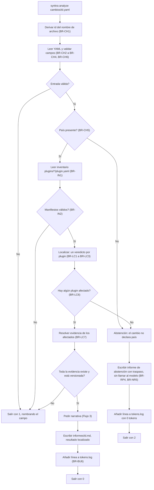
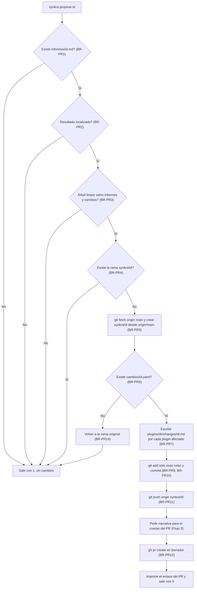
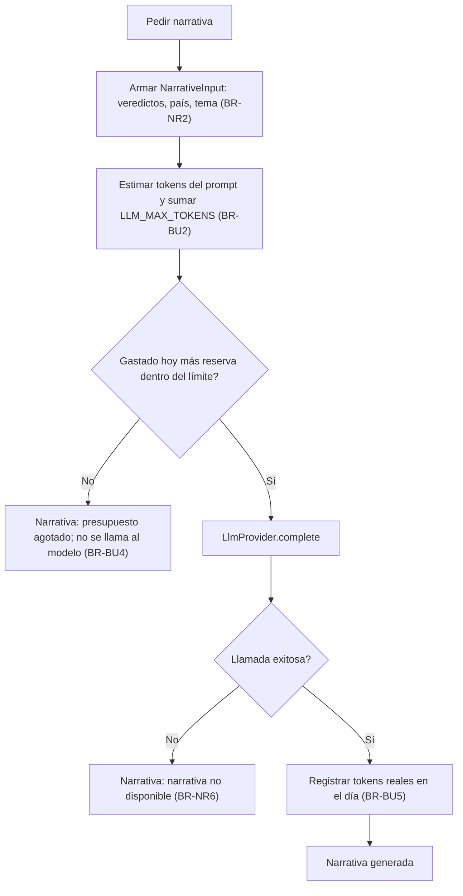
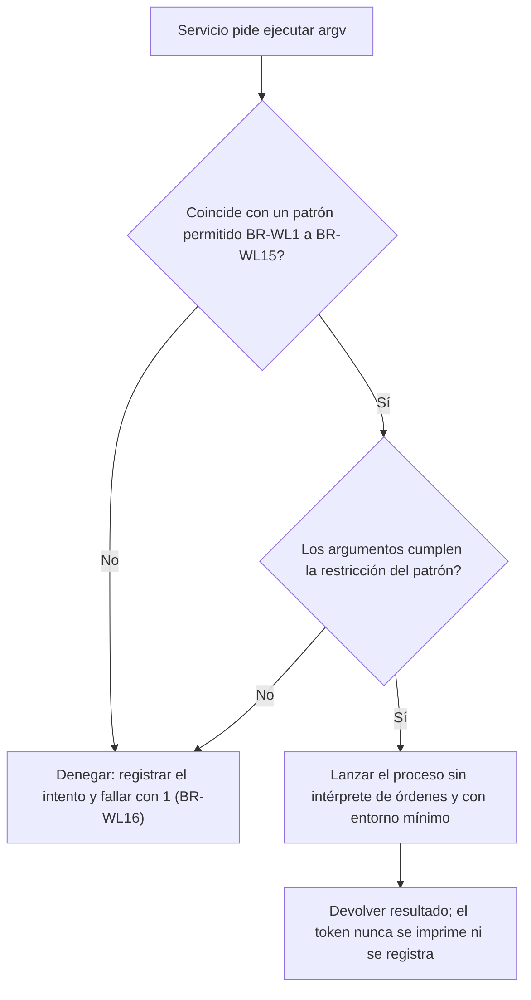

# Modelo de lógica de negocio — U-agent

Flujos del agente. Las reglas citadas están en `business-rules.md`. Independiente de la
tecnología.

## Flujo 1 — `analyze`



Alternativa en texto:

```
1. Derivar el id del nombre del archivo.
2. Leer el YAML. Campo obligatorio ausente, tema fuera del conjunto, campo desconocido, país
   mal formado -> salir con 1.
3. País ausente -> abstención.
4. Leer el inventario. Manifiesto inválido -> salir con 1.
5. Localizar (determinista). Ningún plugin afectado -> abstención.
6. Resolver la evidencia. Falta una ruta -> salir con 1.
7. Pedir la narrativa. Escribir el informe. Añadir la línea de tokens.log. Salir con 0.
8. Abstención: escribir el informe de traspaso sin llamar al modelo; tokens.log con 0; salir con 2.
```

Resultados verificables:

| Entrada | Salida | Código | Regla / historia |
|---|---|---|---|
| Cambio de `pe`, tema `consent` | `plugins/pe` afectado con `ConsentPolicy`; `plugins/co` descartado con motivo | 0 | BR-LC1, BR-LC3 / US-1.3 |
| Cambio sin `text` | Mensaje que nombra `text`; sin informe | 1 | BR-CH3 / US-1.1 |
| Cambio de `ec` | Informe «no puedo localizar» con traspaso | 2 | BR-LC6, BR-RP4 / US-4.1 |
| Cambio sin país | Informe «no puedo localizar» | 2 | BR-CH5 / US-4.1 |
| Cambio con tema `taxes` | Mensaje con los temas válidos | 1 | BR-CH4 |
| `DAILY_TOKEN_BUDGET=0` | Informe con veredictos y «presupuesto agotado» | 0 | BR-BU4 / US-4.3 |

## Flujo 2 — `propose`



Alternativa en texto:

```
1. Sin informe, o informe de abstención -> salir con 1.
2. Árbol sucio (fuera de informes y cambios) -> salir con 1.
3. La rama synkra/<id> ya existe -> salir con 1, nombrándola.
4. git fetch origin main; crear synkra/<id> desde origin/main.
5. Releer cambios/<id>.yaml; si falta, volver a la rama original y salir con 1.
6. Escribir un archivo de solicitud por plugin afectado; añadir solo esas rutas; commit; push.
7. Pedir la narrativa; crear el PR en borrador; imprimir el enlace; salir con 0.
8. Cualquier fallo tras crear la rama: volver a la rama original, dejar la rama nueva y avisar
   de que una persona debe eliminarla.
```

Todo proceso pasa por la lista blanca (Flujo 5). No hay ningún camino hacia `merge`, aprobación,
`gh pr ready` ni empujar a otra rama.

## Flujo 3 — Narrativa con presupuesto



Alternativa en texto:

```
1. Armar la entrada con veredictos, país y tema (nunca el texto libre).
2. Reservar estimación del prompt + LLM_MAX_TOKENS contra el presupuesto del día (UTC).
3. No cabe -> narrativa «presupuesto agotado», sin llamar al modelo.
4. Cabe -> llamar al proveedor. Falla -> «narrativa no disponible». Éxito -> sumar tokens reales.
```

## Flujo 4 — Evaluación

```
1. Para cada eval/dataset/<id>.yaml: ejecutar analyze con LLM_PROVIDER=fake y SYNKRA_REPORT_DIR=eval/out.
2. python eval/score.py:
   a. cargar eval/expected/<id>.json
   b. leer eval/out/<id>.md (filas que empiezan con plugins/ y la línea resultado:)
   c. acumular aciertos, omitidos y sobrantes; contar abstenciones
   d. imprimir recall, precision, abstention_rate y abstention_accuracy
3. Aprobación: recall > 0,90, precisión > 0,70 y tasa de abstención > 0.
```

## Flujo 5 — Decisión de la lista blanca



Alternativa en texto:

```
1. Comparar argv con los patrones permitidos. Sin coincidencia -> denegar.
2. Validar cada argumento (rutas de changes/, rama synkra/<id>, --draft, sin --force).
3. Lanzar sin intérprete de órdenes; el token de GitHub llega por entorno y no se imprime.
```

## Verificación contra las historias

| Historia | Criterio | Cómo lo satisface el diseño |
|---|---|---|
| US-1.1 | Cambio válido da informe y código 0; sin `text` da código distinto de cero y nombra el campo | Flujo 1, BR-CH2, BR-CH3 |
| US-1.2 | `git status --porcelain` solo lista el informe | BR-RP1 |
| US-1.3 | Filas por plugin con veredicto y motivo; número de filas igual al de plugins | BR-LC5, BR-RP2 |
| US-1.4 | Hash de las filas estable entre ejecuciones; punto `ConsentPolicy` para el tema `consent`; veredictos iguales con otro proveedor | BR-LC3, BR-LC4, BR-LC8 |
| US-1.5 | Proveedor `fake` visible en el informe, sin red; la narrativa no cambia veredictos; sin SDK fuera de `claude` | BR-NR1 a BR-NR4, BR-NR9 |
| US-1.6 | Sin informe falla; informe de abstención falla | BR-PR1, BR-PR2 |
| US-1.7 | PR en borrador de `synkra/<id>`, abierto y no fusionado | BR-PR12, BR-PR16 |
| US-1.8 | El diff toca solo el plugin indicado; las rutas del cuerpo existen | BR-PR9, BR-LC7 |
| US-1.9 a US-1.12 | Límites de GitHub y de clúster | BR-AU1 a BR-AU4 (Infrastructure Design) |
| US-3.1 | Sin `propose`, sin rama ni PR; solo el informe en el árbol | BR-RP1 |
| US-4.1 | «no puedo localizar», cuatro campos de traspaso, código 2 | BR-CH5, BR-LC6, BR-RP4 |
| US-4.2 | La inyección no cambia los veredictos | BR-LC4, BR-NR2, BR-RP3, BR-RT1 |
| US-4.3 | Presupuesto 0 da «presupuesto agotado»; línea en el log; `max_tokens` configurado | BR-BU1 a BR-BU6 |
| US-4.4 | Suite sin llamar a la API | BR-NR7, BR-RT2 |
| US-4.5 | Dataset de 20 y puntuación | BR-EV1 a BR-EV5 |
| US-4.6 | Declaración en el README | BR-AU5 |

Las historias US-1.3, US-1.4 y US-4.1 usan palabras en inglés en sus comandos (`affected`,
`discarded`, `original change`); el informe usa español (supuesto 5). Se enmiendan en
`stories.md` (ver la nota del cierre de esta etapa).

## Riesgos y límites

- **Narrativa genérica** (Q7-B): el modelo no ve el texto del cambio, así que la narrativa es breve y genérica. Es el precio de reducir inyección y fuga.
- **Sin comprobación de huella en `propose`** (F2-B): si el YAML cambió tras el análisis, el PR lleva el texto nuevo con el veredicto viejo. El archivo de solicitud lo muestra con `coinciden: no`, pero nada lo bloquea. Es una exposición a fatiga de aprobación (R7).
- **Presupuesto estricto** (Q9-C): 5.000 tokens diarios alcanzan para pocas ejecuciones con `claude`.
- **Rama a medias** (BR-PR14): un fallo tras crear la rama la deja en local; la elimina una persona.
- **Caso de dos países** (Q1-B): un cambio que aplica a dos países son dos archivos y dos informes; el indicador del PRD «cambios fusionados en todos los plugins afectados» se mide sumando sus PR.
