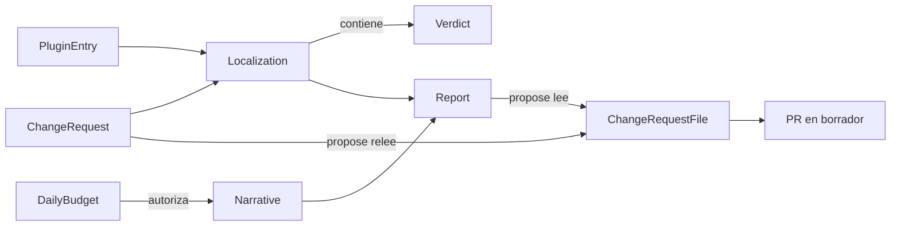

# Entidades de dominio — U-agent

Respuestas que lo condicionan (`U-agent-functional-design-plan.md`): Q1-B, Q2-A, Q3-A, Q4-B,
Q5-A, Q6-B, Q7-B, Q8-A, Q9-C, Q10-A, Q11-A, F1-B, F2-B, más los supuestos 1 a 7 del plan y
los supuestos 8 a 11 de este documento. Independiente de la tecnología.

## Cambio (entrada de `analyze`)

`ChangeRequest`, leído de `cambios/<id>.yaml`:

| Campo | Tipo | Obligatorio | Regla |
|---|---|---|---|
| `id` | cadena | Derivado | Es el nombre del archivo sin extensión (Q3-A). Solo minúsculas, dígitos y guion; se usa en la rama y en archivos |
| `country` | `CountryCode` (de `core`) | Sí | Un solo país (Q1-B). Ausente o vacío da abstención; presente pero no de dos letras da error de entrada |
| `topic` | `Topic` (de `core`) | Sí | Un solo tema (Q2-A): `document`, `consent` o `retention`. Otro valor es error de entrada (Q5-A) |
| `text` | cadena | Sí | Texto del cambio, ya interpretado por un humano |
| `reference` | cadena | No | Cita opcional de la circular de origen |
| `hash` | cadena | Derivado | SHA-256 en hexadecimal de los bytes del archivo |

Los campos desconocidos se rechazan como error de entrada (supuesto 8).

Ejemplo ilustrativo (país ficticio):

```
country: XX
topic: consent
text: El consentimiento debe incluir la finalidad del tratamiento.
reference: Circular ficticia 1 de 2026
```

## Plugin del inventario

`PluginEntry`: directorio del plugin (`plugins/<dir>`), `PluginManifest` leído con el
`ManifestReader` de `core` (id, country, version, tres puntos con `sourceFile`, temas).

## Veredicto y localización

| Entidad | Campos |
|---|---|
| `Verdict` | `plugin` (ruta `plugins/<dir>`), `status` (`afectado` o `descartado`), `extensionPoint` (solo si afectado), `reason` (texto), `evidence` (lista de rutas, solo si afectado) |
| `Localization` | lista de `Verdict` ordenada por ruta de plugin, y `abstention` (motivo, si no hay ningún plugin afectado) |

Correspondencia tema a punto (de `core`): `document` → `DocumentValidator`,
`consent` → `ConsentPolicy`, `retention` → `RetentionPolicy`.

Resultados posibles de `analyze`: `localizado` (hay al menos un plugin afectado) o `abstención`.

## Informe

`Report`, archivo `informes/<id>.md` (o el directorio de `SYNKRA_REPORT_DIR`):

| Sección | Contenido |
|---|---|
| Encabezado | `cambio` (ruta del archivo), `huella` (SHA-256), `país`, `tema`, `resultado` (`localizado` o `abstención`), `proveedor`, `tokens` (entrada, salida, total), `generado` (UTC ISO-8601) |
| Veredictos | Tabla con columnas `plugin`, `veredicto`, `punto de extensión`, `motivo`, `evidencia`. Una fila por plugin del inventario. Cada fila comienza con la barra vertical de tabla seguida de la ruta `plugins/` |
| Narrativa | Texto redactado por el modelo, o la nota «narrativa no disponible», o «presupuesto agotado» |
| Traspaso | Solo en abstención: `cambio original`, `plugins revisados`, `motivo de abstención`, `tokens gastados`. Incluye la frase «no puedo localizar» |

El informe **no** contiene el texto del cambio, solo su ruta y su huella (Q6-B).

## Narrativa y modelo

| Entidad | Campos |
|---|---|
| `NarrativeInput` | tabla de veredictos, país, tema. Sin el texto libre del cambio (Q7-B) |
| `LlmRequest` | `system`, `prompt`, `maxTokens` |
| `LlmResponse` | `text`, `tokensIn`, `tokensOut` |
| `Narrative` | `text` y `status` (`generada`, `no disponible`, `presupuesto agotado`) |

## Presupuesto y uso

| Entidad | Campos |
|---|---|
| `DailyBudget` | `dateUtc`, `limit` (por defecto 5.000 tokens, Q9-C), `spent` |
| `TokenUse` | `tokensIn`, `tokensOut`, `total` de una ejecución |
| `TokenLogLine` | marca de tiempo UTC, `run` (identificador corto), `change` (id), `provider`, `in`, `out`, `total` |

Archivos: `agent/state/budget-YYYY-MM-DD.json` y `agent/logs/tokens.log` (ambos ignorados por Git).

## Solicitud de cambio (archivo que escribe `propose`)

`ChangeRequestFile`, `plugins/<dir>/changes/<id>.md`:

| Sección | Contenido |
|---|---|
| Encabezado | `cambio` (id), `país`, `tema`, `punto de extensión`, `estado: pendiente de revisión humana` |
| Huellas | `huella del informe` (la del análisis), `huella del archivo leído` (la de `propose`) y `coinciden: sí/no` (informativo, F2-B; no detiene nada) |
| Texto del cambio | El texto original dentro de un bloque delimitado cuya valla es más larga que cualquier secuencia de comillas invertidas del texto |
| Evidencia | Rutas de los archivos que respaldan el veredicto |

## Propuesta (PR)

| Campo | Valor |
|---|---|
| Rama | `synkra/<id>` |
| Base | `main` |
| Estado | Borrador (`--draft`) |
| Título | `[SynKra] <id>: <tema> en <país>` |
| Cuerpo | Aviso de borrador y de revisión humana obligatoria; fila de veredicto; evidencia; narrativa o nota; huellas. **No** incluye el texto del cambio |

## Lista blanca de comandos

`AllowedCommand`: patrón de argumentos permitidos, con validación de cada argumento. Todo lo que
no coincida está denegado.

## Evaluación

| Entidad | Campos |
|---|---|
| `DatasetCase` | `cambios`-formato en `eval/dataset/<id>.yaml` (país escrito en mayúsculas, por ejemplo `country: CO`) |
| `ExpectedResult` | `eval/expected/<id>.json`: `outcome` (`localizado` o `abstencion`), `affected` (lista de rutas de plugin), `points` (plugin a punto de extensión) |
| `Score` | `recall`, `precision`, `abstention_rate`, `abstention_accuracy` |

Distribución del dataset (F1-B): 20 casos simples de un solo país y un solo tema: 10 de `CO`,
8 de `PE`, 2 de un país sin plugin. La inyección y los demás casos difíciles se cubren con las
pruebas de red-teaming, no con el dataset.

## Configuración

| Variable | Significado | Por defecto |
|---|---|---|
| `LLM_PROVIDER` | `claude` o `fake` | `fake` (supuesto 9) |
| `LLM_MODEL` | Modelo del adaptador `claude` | `claude-haiku-5-5` |
| `LLM_MAX_TOKENS` | Tope de salida por llamada | `300` |
| `DAILY_TOKEN_BUDGET` | Presupuesto diario de tokens | `5000` |
| `SYNKRA_REPO_ROOT` | Raíz del repositorio | directorio actual |
| `SYNKRA_REPORT_DIR` | Directorio de informes | `informes` |
| `SYNKRA_STATE_DIR` | Estado del presupuesto | `agent/state` |
| `SYNKRA_LOG_DIR` | Log de tokens | `agent/logs` |
| `ANTHROPIC_API_KEY_FILE` | Archivo con la clave de la API | sin valor |
| `AGENT_TOKEN_FILE` | Archivo con el token de GitHub del agente | sin valor |

## Supuestos nuevos de este documento (confirma al aprobar)

8. Los campos desconocidos en el YAML del cambio son un error de entrada.
9. El proveedor por defecto es `fake`, para que una ejecución sin configurar nunca llame a la API.
10. La huella es el SHA-256 de los bytes del archivo, en hexadecimal.
11. Los directorios `agent/state/` y `agent/logs/` están ignorados por Git (ya lo prevé `U-scaffold`).

## Relaciones



Alternativa en texto:

```
ChangeRequest + PluginEntry -> Localization (lista de Verdict)
Localization + Narrative -> Report
DailyBudget autoriza la generación de Narrative
propose lee Report y relee ChangeRequest -> ChangeRequestFile -> PR en borrador
```
