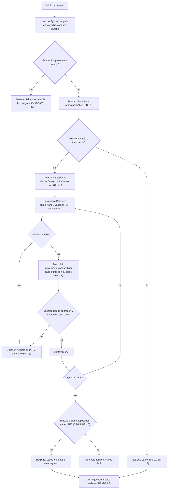
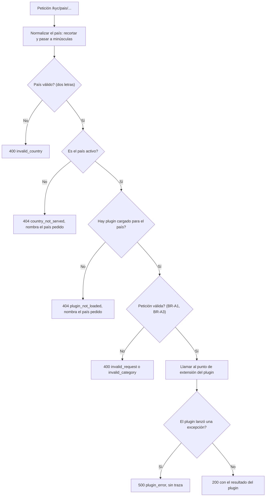

# Modelo de lógica de negocio — U-core

Flujos del kernel. Las reglas citadas están en `business-rules.md`; las entidades, en
`domain-entities.md`. Independiente de la tecnología.

## Flujo 1 — Arranque y carga de plugins



Alternativa en texto:

```
1. Leer configuración. Sin país activo válido -> detener.
2. Listar los .jar (orden alfabético). Si no hay -> registro vacío y arranque terminado.
3. Crear un cargador de clases único con todos los JAR.
4. Por cada JAR: leer y validar plugin.yaml; descubrir las tres implementaciones;
   comprobar que cada clase del manifiesto existe y viene de ese JAR.
   Cualquier fallo -> detener, nombrando JAR y motivo.
5. Comprobar duplicados de país, id o clase entre JAR. Duplicado -> detener, nombrando ambos JAR.
6. Registrar los plugins. Arranque terminado; readiness UP.
```

Resultados de arranque (verificables):

| Situación | Resultado | Historia o regla |
|---|---|---|
| Un JAR consistente del país activo | Arranca; `/plugins` lista el plugin | US-2.3 |
| Directorio vacío | Arranca; `/plugins` devuelve `[]` | US-2.3, BR-L7 |
| JAR sin `plugin.yaml` | No arranca; código de salida distinto de cero | BR-M1, BR-L6 |
| Dos JAR del mismo país | No arranca; el mensaje nombra ambos | BR-L4 |
| Sin `synkra.country` | No arranca | BR-C1 |

## Flujo 2 — Petición KYC



Alternativa en texto:

```
1. Normalizar el país de la ruta.
2. No es de dos letras -> 400 invalid_country.
3. No es el país activo -> 404 country_not_served.
4. No hay plugin cargado para él -> 404 plugin_not_loaded.
5. Petición mal formada -> 400 invalid_request o invalid_category.
6. Llamar al plugin. Excepción -> 500 plugin_error. Si no -> 200 con el resultado.
```

### Operaciones y su contrato

| Operación | Entrada | Salida 200 | Regla |
|---|---|---|---|
| Validar documento | `type`, `number` | `valid`, `reasonCodes`, `ruleRefs` | BR-A1 |
| Consultar consentimiento | — | `requiredFields`, `purposeRequired`, `ruleRefs` | BR-A2 |
| Consultar retención | `category` | `years`, `ruleRefs` | BR-A3 |

Un documento inválido produce 200 con `valid: false`; el 4xx se reserva para peticiones mal
formadas o fuera de servicio.

## Flujo 3 — Listado de plugins

```
GET /plugins
  1. Tomar todos los plugins del registro (incluye países distintos del activo, BR-L8).
  2. Convertir cada uno en PluginSummary (id, country, version, nombres de los tres puntos).
  3. Ordenar por id.
  4. Responder 200 con la lista (vacía si no hay plugins).
```

No hay error posible en este flujo: el listado solo lee el registro en memoria.

## Flujo 4 — Salud

```
Liveness : UP mientras el proceso responde.
Readiness: UP cuando el arranque terminó. El estado de los plugins se mira en /plugins.
```

Cuando el arranque falla (Flujo 1, rutas de detener), el proceso termina y ninguna sonda
responde `UP`, así que un pod `Ready` siempre tiene JAR consistentes.

## Verificación contra las historias

| Historia | Criterio | Cómo lo satisface el diseño |
|---|---|---|
| US-2.2 | `grep` sin resultados en `core/src`; tres interfaces | BR-I1, BR-I2; los tres contratos de `domain-entities.md` |
| US-2.3 | Con `pe` montado, `/plugins` lista `pe` con tres puntos y versión | Flujo 1 y Flujo 3 |
| US-2.3 | Con directorio vacío, lista vacía y el kernel sigue arriba | BR-L7, F1-A |
| US-2.4 | `/actuator/health` contiene `UP` | Flujo 4 |
| US-2.4 | Probes en el Deployment | Verificación de `U-deploy` (criterio compartido) |
| US-2.5 | Documento válido da 200 | Flujo 2, BR-A1 |
| US-2.5 | Otro país da 404 que nombra el país | Flujo 2, comprobación 2, BR-I3 |
| US-2.5 | Sin dependencias de base de datos | BR-A4 |

Los elementos del diseño no nombran ningún país: los ejemplos usan países ficticios (`xx`, `yy`).
Las únicas menciones de `pe` están en la columna "Criterio" de la tabla anterior, que cita las
historias; esta documentación vive en `aidlc-docs/`, fuera de `core/src`.

## Preguntas abiertas para siguientes etapas

- NFR Requirements se omite para esta unidad (pila decidida). Los tiempos de arranque y de respuesta no tienen umbral en los requisitos; si hace falta uno, se agrega como NFR nuevo.
- El diseño de despliegue (probes, `Deployment`, init container) corresponde a `U-deploy`.
