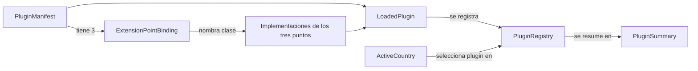

# Entidades de dominio — U-core

Diseño independiente de la tecnología. Respuestas que lo condicionan: Q1-A, Q3-A, Q4-B, Q5-A,
Q6-A, Q7-B, Q9-B de `U-core-functional-design-plan.md`.

## Valores y enumeraciones

| Elemento | Definición | Notas |
|---|---|---|
| `CountryCode` | Dos letras (ISO 3166-1 alpha-2), normalizadas a minúsculas | Se compara sin distinguir mayúsculas; se recorta el espacio |
| `ExtensionPoint` | Enumeración cerrada: `DocumentValidator`, `ConsentPolicy`, `RetentionPolicy` | Son los tres contratos del kernel |
| `Topic` | Enumeración cerrada: `document`, `consent`, `retention` (Q1-A) | Cada tema corresponde a un punto de extensión, de forma fija |
| `DataCategory` | Enumeración cerrada: `IDENTITY_DATA`, `CONSENT_RECORD`, `KYC_FILE` (Q6-A) | Entrada de la política de retención |

**Correspondencia fija tema a punto de extensión:**

| Tema | Punto de extensión |
|---|---|
| `document` | `DocumentValidator` |
| `consent` | `ConsentPolicy` |
| `retention` | `RetentionPolicy` |

Esta correspondencia pertenece al kernel. El agente la reutiliza al decidir qué punto toca un
cambio, por lo que el manifiesto no necesita repetirla.

## Tipos de los puntos de extensión

| Entidad | Campos | Quién la produce |
|---|---|---|
| `DocumentRequest` | `type` (cadena libre, Q3-A), `number` (cadena) | Cliente de la API |
| `ValidationResult` | `valid` (booleano), `reasonCodes` (lista de cadenas libres, Q4-B), `ruleRefs` (lista de identificadores de regla del plugin) | Plugin |
| `ConsentRequirements` | `requiredFields` (lista de nombres), `purposeRequired` (booleano), `ruleRefs` | Plugin |
| `RetentionRule` | `years` (entero, Q7-B), `ruleRefs` | Plugin |

Notas:
- Los códigos de motivo son libres por plugin (Q4-B). Convención recomendada, no obligatoria: `UNSUPPORTED_TYPE` cuando el tipo de documento no se reconoce. El kernel no interpreta los códigos.
- `ruleRefs` son identificadores que el plugin define. El kernel solo los transporta (Q11-B: no hay catálogo de reglas en el contrato).

## Manifiesto del plugin

`PluginManifest` (archivo `plugin.yaml` en la raíz del JAR del plugin):

| Campo | Tipo | Obligatorio | Regla |
|---|---|---|---|
| `id` | cadena | Sí | Minúsculas, dígitos y guion; único entre los plugins cargados |
| `country` | `CountryCode` | Sí | Dos letras |
| `version` | cadena | Sí | No vacía |
| `extensionPoints` | lista de `ExtensionPointBinding` | Sí | Exactamente los tres puntos, una vez cada uno |
| `topics` | lista de `Topic` | Sí | Al menos uno; sin repetidos |

`ExtensionPointBinding`:

| Campo | Tipo | Regla |
|---|---|---|
| `point` | `ExtensionPoint` | Uno de los tres |
| `implementationClass` | nombre completo de clase | No vacío; debe existir y ser descubierta por el mecanismo de servicios |
| `sourceFile` | ruta relativa a la raíz del repositorio | No vacía; la usa el agente como evidencia (no la verifica el kernel) |

Forma ilustrativa del manifiesto (no es código del producto; los nombres de ejemplo son ficticios):

```
id: xx-kyc
country: xx
version: 0.1.0
extensionPoints:
  - point: DocumentValidator
    implementationClass: com.example.xx.XxDocumentValidator
    sourceFile: plugins/xx/src/main/java/com/example/xx/XxDocumentValidator.java
  - point: ConsentPolicy
    implementationClass: com.example.xx.XxConsentPolicy
    sourceFile: plugins/xx/src/main/java/com/example/xx/XxConsentPolicy.java
  - point: RetentionPolicy
    implementationClass: com.example.xx.XxRetentionPolicy
    sourceFile: plugins/xx/src/main/java/com/example/xx/XxRetentionPolicy.java
topics: [document, consent, retention]
```

**Enmienda a Application Design.** `TopicBinding(topic, point)` de `component-methods.md` queda
reemplazado por la lista simple `topics` más la correspondencia fija tema a punto (Q1-A). El
resultado es el mismo y evita que un manifiesto contradiga la correspondencia.

## Plugin cargado y registro

| Entidad | Campos | Notas |
|---|---|---|
| `LoadedPlugin` | `manifest`, `documentValidator`, `consentPolicy`, `retentionPolicy`, `jarPath` | Producido por el cargador tras validar |
| `PluginRegistry` | colección de `LoadedPlugin` indexada por `CountryCode` e `id` | Solo en memoria; sin persistencia |
| `ActiveCountry` | `CountryCode` | Viene de la configuración; obligatorio |
| `PluginSummary` | `id`, `country`, `version`, `extensionPoints` (lista de nombres) | Salida de `GET /plugins` |

## Respuesta de error

`ErrorResponse` (Q9-B): `error` (código estable en minúsculas con guion bajo) y `message` (texto
legible que nombra el país o el campo cuando aplica).

Códigos: `invalid_country`, `country_not_served`, `plugin_not_loaded`, `invalid_request`,
`invalid_category`, `plugin_error`.

## Relaciones



Alternativa en texto:

```
PluginManifest (1) -> ExtensionPointBinding (3, uno por punto)
ExtensionPointBinding -> clase de implementación
PluginManifest + implementaciones -> LoadedPlugin
LoadedPlugin -> PluginRegistry -> PluginSummary
ActiveCountry selecciona el plugin del registro que atiende peticiones
```
