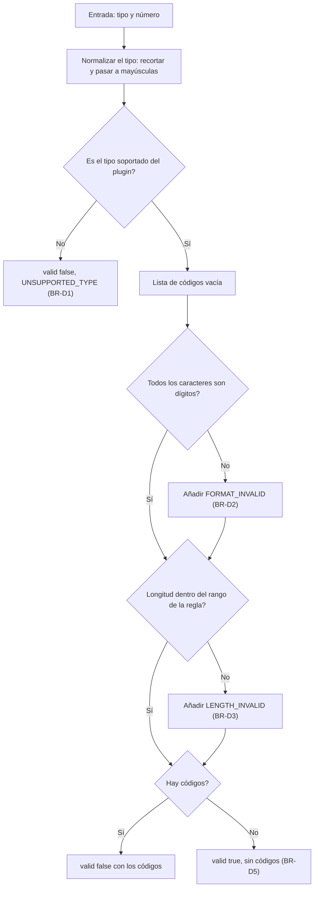
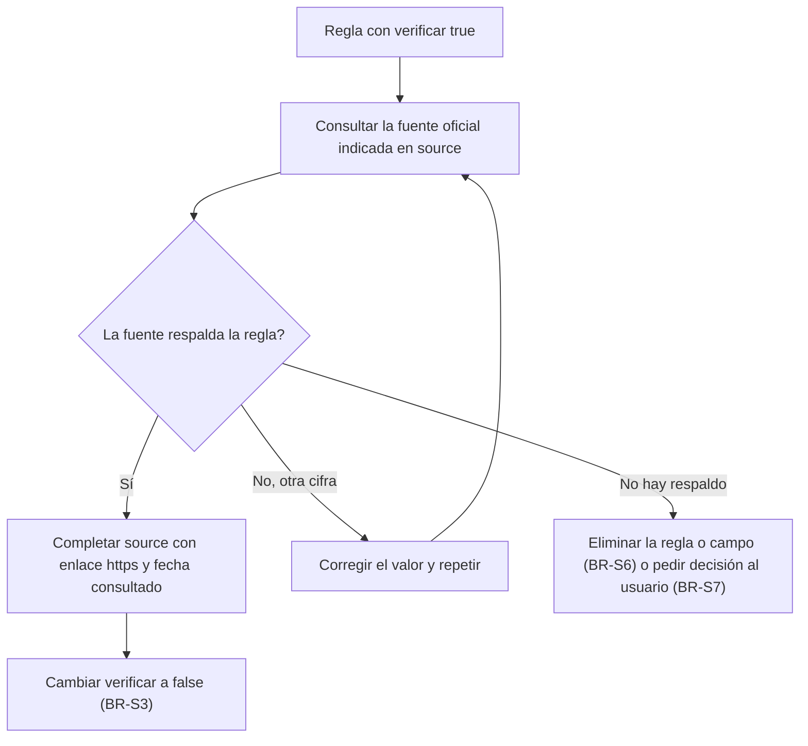

# Modelo de lógica de negocio — U-plugins

Flujos de cada plugin. Las reglas citadas están en `business-rules.md`. Todas las reglas son
provisionales (Q7-C). Los dos plugins comparten la forma del flujo; cambian el tipo soportado,
el rango de longitud, los campos de consentimiento y los identificadores de regla.

## Flujo 1 — Validar un documento



Alternativa en texto:

```
1. Normalizar el tipo (recortar, mayúsculas).
2. Tipo no soportado -> valid false con UNSUPPORTED_TYPE y fin.
3. Si el número tiene algún carácter que no es dígito -> añadir FORMAT_INVALID.
4. Si la longitud está fuera del rango -> añadir LENGTH_INVALID.
5. Sin códigos -> valid true. Con códigos -> valid false con la lista.
6. ruleRefs lista las reglas de documento del plugin en cualquier caso (BR-D7).
```

Tabla de decisión:

| ¿Tipo soportado? | ¿Solo dígitos? | ¿Longitud en rango? | `valid` | `reasonCodes` |
|---|---|---|---|---|
| No | — | — | false | `UNSUPPORTED_TYPE` |
| Sí | Sí | Sí | true | vacío |
| Sí | No | Sí | false | `FORMAT_INVALID` |
| Sí | Sí | No | false | `LENGTH_INVALID` |
| Sí | No | No | false | `FORMAT_INVALID`, `LENGTH_INVALID` |

## Flujo 2 — Consultar requisitos de consentimiento

```
1. El kernel llama a requirements() del plugin del país activo.
2. El plugin devuelve, siempre iguales: requiredFields (lista fija del plugin),
   purposeRequired = true y ruleRefs = [<PAIS>-CON-001].
3. Sin entrada, sin estado, sin evaluación de registros (BR-CS4).
```

## Flujo 3 — Consultar retención

```
1. El kernel valida la categoría (IDENTITY_DATA, CONSENT_RECORD, KYC_FILE) y llama al plugin.
2. El plugin devuelve years = 5 y ruleRefs = [<PAIS>-RET-00N] según la categoría (BR-R1, BR-R2).
3. La respuesta no indica que el valor es provisional (BR-R3).
```

## Flujo 4 — Verificación de una regla (paso del plan de Code Generation)



Alternativa en texto:

```
1. Tomar una regla con verificar true.
2. Consultar la fuente oficial citada en source.
3. Si la respalda: completar source con enlace https y fecha de consulta; verificar pasa a false.
4. Si la fuente da otra cifra: corregir el valor y volver a consultar.
5. Si no hay respaldo: eliminar la regla o el campo, o pedir una decisión al usuario.
```

## Flujo 5 — Carga en el kernel (vista del plugin)

```
1. El kernel lee plugin.yaml del JAR y lo valida (U-core BR-M1 a BR-M7).
2. El kernel descubre las tres clases por el mecanismo de servicios y las liga al manifiesto.
3. El plugin no hace nada más en la carga: no abre conexiones ni lee archivos externos.
```

## Verificación contra las historias

| Historia | Criterio | Cómo lo satisface el diseño |
|---|---|---|
| US-2.6 | El overlay `co` lista solo `co` con los tres puntos; `mvn -pl plugins/co test` pasa | BR-MF1, BR-MF3; flujos 1 a 3 |
| US-2.7 | El overlay `pe` lista solo `pe` con los tres puntos; `mvn -pl plugins/pe test` pasa | Ídem |
| US-2.8 | `ManifestTest` pasa; falla si falta una clase del manifiesto | BR-MF1 a BR-MF3 y U-core BR-L3 |
| US-2.9 | `RuleSourceTest` pasa; falla si una regla no tiene `source` ni `verificar`; las `verificar` están excluidas de aceptación | BR-S1 a BR-S4, BR-T1 |
| US-2.10 | `dependency:tree` de cada plugin sin el otro; `mvn package` genera dos JAR | BR-I1, BR-I2 |
| US-2.5 (compartida) | Un documento aceptado por la regla responde 200 | Flujo 1, BR-T1 |

## Riesgos y límites

- **Reglas provisionales** (R8 del PRD): todas las respuestas usan valores de trabajo. La API no lo indica (F1-A). La mitigación es documental: README del módulo y demo (BR-T3).
- **Verificación pendiente**: BR-S5 la define como un paso del plan. Mientras no se ejecute, no hay ninguna regla verificada y no se puede afirmar cumplimiento normativo.
- **Variación entre países**: queda en el tipo de documento, el rango de longitud y los campos de consentimiento; la retención coincide (F2-A).
