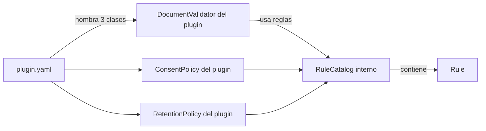

# Entidades de dominio — U-plugins

Respuestas que lo condicionan (`U-plugins-functional-design-plan.md`): Q1-C, Q2-B, Q3-B, Q4-A,
Q5-A, Q6-B, Q7-C, Q8-B, Q9-B, F1-A, F2-A. Contratos del kernel: `U-core/functional-design/`.

> **Estado de las reglas: todas provisionales.** Por Q7-C ninguna regla de este diseño tiene
> fuente primaria verificada. Cada una lleva la marca `verificar`. Los nombres de normas que
> aparecen son la fuente **prevista** a consultar, sin números de artículo ni contenido
> afirmado. La verificación es un paso del plan de Code Generation.

## Plugins

| Atributo | Plugin `co` | Plugin `pe` |
|---|---|---|
| `id` del manifiesto | `co-kyc` | `pe-kyc` |
| `country` | `co` | `pe` |
| `version` | `0.1.0` | `0.1.0` |
| `topics` | `document`, `consent`, `retention` | `document`, `consent`, `retention` |
| Paquete Java | `com.synkra.plugin.colombia` | `com.synkra.plugin.peru` |
| Tipo de documento soportado (Q1-C) | `CC` (cédula de ciudadanía) | `DNI` (documento nacional de identidad) |
| Fuente prevista, documento | Registraduría Nacional del Estado Civil | RENIEC |
| Fuente prevista, consentimiento y retención | Ley 1581 de 2012 y su reglamentación | Ley 29733 y su reglamento |

El manifiesto de cada plugin sigue el modelo de U-core: tres `ExtensionPointBinding`
(`DocumentValidator`, `ConsentPolicy`, `RetentionPolicy`), cada uno con `implementationClass` y
`sourceFile`.

## Regla y catálogo de reglas (interno del plugin)

`RuleCatalog` no forma parte del contrato del kernel (U-core Q11-B). Es un componente interno
de cada plugin, construido desde constantes en el código (Q9-B).

| Entidad | Campos | Notas |
|---|---|---|
| `Rule` | `id`, `kind` (`document`, `consent`, `retention`), `description`, `source`, `verificar` (booleano), `provisionalNote` | `source` es texto libre con la cita (Q8-B) |
| `RuleCatalog` | lista de `Rule` del plugin | Se consulta desde las pruebas; el kernel no la ve |

Convención de `id`: `<PAIS>-<TIPO>-<NNN>` en mayúsculas, por ejemplo `CO-DOC-001`. Es el valor
que viaja en `ruleRefs` sin prefijos ni marcas (F1-A: la API no muestra el estado).

## Reglas de documento (provisionales)

| Atributo | `co` | `pe` |
|---|---|---|
| Tipo soportado | `CC` | `DNI` |
| Caracteres permitidos | Solo dígitos (Q3-B) | Solo dígitos (Q3-B) |
| Longitud | 6 a 10 dígitos | 8 dígitos |
| Dígito de control | No se valida (Q2-B) | No se valida (Q2-B) |

Los límites de longitud son valores de trabajo del diseño, no cifras verificadas. Las
normas o entidades indicadas arriba son donde deben confirmarse.

## Convención de códigos de motivo (Q4-A)

Cadenas comunes a ambos plugins:

| Código | Cuándo aparece |
|---|---|
| `UNSUPPORTED_TYPE` | El tipo de documento no es el soportado por el plugin |
| `FORMAT_INVALID` | El número contiene algún carácter que no es un dígito |
| `LENGTH_INVALID` | La longitud del número está fuera del rango de la regla |
| `CHECKSUM_INVALID` | Reservado. No lo emite ningún plugin en este alcance (Q2-B) |

## Requisitos de consentimiento (provisionales, Q5-A)

`requiredFields` son identificadores estables. Los candidatos salen del deber de informar al
titular que cada marco legal prevé, y todos quedan por confirmar artículo por artículo.

| Atributo | `co` | `pe` |
|---|---|---|
| `purposeRequired` | `true` | `true` |
| `requiredFields` (candidatos) | `purpose`, `controller_identity`, `holder_rights`, `sensitive_data_optional_notice` | `purpose`, `recipients`, `data_bank_existence`, `controller_identity`, `transfer_notice` |
| Fuente prevista | Ley 1581 de 2012 y su reglamentación: deber de informar al titular | Ley 29733 y su reglamento: derecho de información del titular |

Los campos que no se logren sustentar con un artículo se eliminan al verificar, no se conservan
como «prácticos» (Q5-A: solo lo que la norma exige).

## Retención (provisional, F2-A)

| Categoría | `co` (años) | `pe` (años) |
|---|---|---|
| `IDENTITY_DATA` | 5 | 5 |
| `CONSENT_RECORD` | 5 | 5 |
| `KYC_FILE` | 5 | 5 |

El 5 es un valor **arbitrario** de trabajo. No proviene de ninguna norma. Ambos países
coinciden en retención hasta que se verifique la fuente (F2-A).

## Catálogo inicial de reglas

| Id | Plugin | Tipo | Descripción | `verificar` |
|---|---|---|---|---|
| `CO-DOC-001` | co | document | Solo se soporta el tipo `CC` | Sí |
| `CO-DOC-002` | co | document | El número contiene solo dígitos | Sí |
| `CO-DOC-003` | co | document | El número tiene entre 6 y 10 dígitos | Sí |
| `CO-CON-001` | co | consent | Campos de información obligatorios y finalidad obligatoria | Sí |
| `CO-RET-001` | co | retention | Retención de `IDENTITY_DATA`: 5 años (arbitrario) | Sí |
| `CO-RET-002` | co | retention | Retención de `CONSENT_RECORD`: 5 años (arbitrario) | Sí |
| `CO-RET-003` | co | retention | Retención de `KYC_FILE`: 5 años (arbitrario) | Sí |
| `PE-DOC-001` | pe | document | Solo se soporta el tipo `DNI` | Sí |
| `PE-DOC-002` | pe | document | El número contiene solo dígitos | Sí |
| `PE-DOC-003` | pe | document | El número tiene exactamente 8 dígitos | Sí |
| `PE-CON-001` | pe | consent | Campos de información obligatorios y finalidad obligatoria | Sí |
| `PE-RET-001` | pe | retention | Retención de `IDENTITY_DATA`: 5 años (arbitrario) | Sí |
| `PE-RET-002` | pe | retention | Retención de `CONSENT_RECORD`: 5 años (arbitrario) | Sí |
| `PE-RET-003` | pe | retention | Retención de `KYC_FILE`: 5 años (arbitrario) | Sí |

Total: 14 reglas, todas con `verificar`.

## Relaciones



Alternativa en texto:

```
plugin.yaml nombra las 3 clases de implementación.
Cada clase usa el RuleCatalog interno del plugin.
El RuleCatalog contiene objetos Rule (id, tipo, descripción, fuente, verificar).
El kernel solo ve los resultados y los ruleRefs, nunca el catálogo.
```
