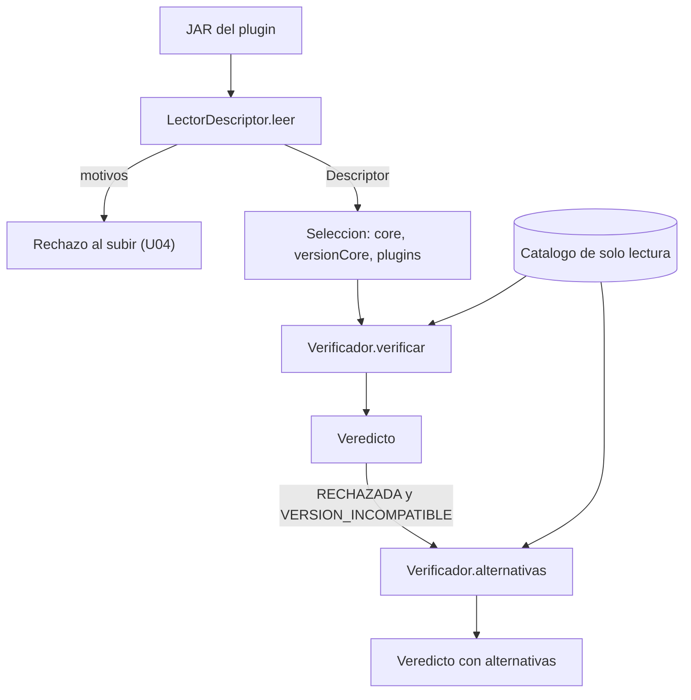

# U01 · Modelo de lógica

## Flujos

_Texto alternativo:_ el lector convierte un JAR en un descriptor o en motivos de rechazo. Una
selección (core, versión y descriptores) entra al verificador junto con un catálogo de solo
lectura y sale un veredicto. Si hay incompatibilidad de versión, el paso de alternativas consulta
el mismo catálogo y añade las sugerencias.

## Quién lo usa

| Consumidor | Usa | Para |
|---|---|---|
| U04 Catálogo | `LectorDescriptor.leer`, `RangoVersion.parsear` | Rechazar al subir (H-03) |
| U07 Despliegue | `verificar` + `alternativas` | Verificación en vivo y plan (H-08, H-09, H-11) |
| U02 Core | `LectorDescriptor.leer` + `verificar` | Arranque (H-21) |
| U02 y U07 (pruebas) | `SuiteCombinaciones.casos()` | La misma suite en los dos lados (H-10, R1) |

## Suite de combinaciones (PRD §11.1)

Catálogo fijo de la suite: core `synkra-core` con versiones `2.1.0` y `3.0.0`; plugins `kyc-co
1.0.0` (`2.x`), `kyc-pe 1.3.0` (`2.x`), `kyc-pe 2.0.0` (`3.x`); core `otro-core 1.0.0` con
`kyc-xx 1.0.0` (`1.x`).

| # | Grupo | Selección | Esperado |
|---|---|---|---|
| S1 | Válidas | `synkra-core 2.1.0` + `kyc-co 1.0.0` | APROBADA |
| S2 | Válidas | `synkra-core 2.1.0` + `kyc-pe 1.3.0` | APROBADA |
| S3 | Válidas | `synkra-core 2.1.0` sin plugins | APROBADA |
| S4 | Versión incompatible | `synkra-core 2.1.0` + `kyc-pe 2.0.0` | RECHAZADA `VERSION_INCOMPATIBLE`; alternativas `kyc-pe 1.3.0` y core `3.0.0` |
| S5 | Versión incompatible | `synkra-core 3.0.0` + `kyc-co 1.0.0` | RECHAZADA `VERSION_INCOMPATIBLE`; sin alternativa de plugin, alternativa core `2.1.0` |
| S6 | Plugin ausente | `synkra-core 2.1.0` + `kyc-mx 1.0.0` | RECHAZADA `PLUGIN_AUSENTE` |
| S7 | Carpeta equivocada | `synkra-core 2.1.0` + `kyc-xx 1.0.0` (de `otro-core`) | RECHAZADA `CORE_EQUIVOCADO` |
| S8 | Descriptor incompleto | JAR sin `coreCompatible` | `DESCRIPTOR_FALTA_CAMPO` |
| S9 | Descriptor incompleto | JAR con `coreCompatibel` | `DESCRIPTOR_CAMPO_DESCONOCIDO` + `DESCRIPTOR_FALTA_CAMPO` |
| S10 | Repetido | `synkra-core 2.1.0` + `kyc-pe 1.3.0` + `kyc-pe 2.0.0` | RECHAZADA `PLUGIN_REPETIDO` |
| S11 | Integridad | — | Fuera de U01: hash al subir (U04) y al descargar (U05). La suite lo declara y remite a sus pruebas |
| S12 | Plugin no activado | — | Fuera de U01: el core no carga lo que no pide el ConfigMap (U02) |

## Propiedades (PBT parcial)

| Regla | Propiedad | Generador (PBT-07) |
|---|---|---|
| PBT-02 | `desdeYaml(d.aYaml()) == d` para todo descriptor válido | Nombres que cumplen el patrón, versiones `0..50`, los cuatro tipos de rango, 0 a 5 etiquetas |
| PBT-02 | `RangoVersion.parsear(r.texto())` da el mismo intervalo | Los cuatro tipos de rango |
| PBT-03 | Para todo `N` y toda `v`: `parsear("N.x").incluye(v)` ⇔ `v.mayor == N` | `N` y `v` en `0..50` |
| PBT-03 | `verificar` es determinista y no depende del orden de llamadas | Selecciones aleatorias sobre el catálogo de la suite |
| PBT-03 | Toda alternativa sugerida da `APROBADA` al aplicarse | Selecciones con `VERSION_INCOMPATIBLE` |
| PBT-08 | Semilla fija registrada y reducción automática del contraejemplo | La del framework |
| PBT-09 | **jqwik** sobre JUnit 5 (se ejecuta con `./gradlew :verificador:test`) | |

## Cumplimiento de extensiones

| Regla | Estado |
|---|---|
| AUTONOMIA-01 | N/A: U01 no toca el clúster |
| AUTONOMIA-02 | Cumple: cada regla y caso se comprueba con `./gradlew :verificador:check` |
| PBT-02, 03, 07, 08, 09 | Cumple: propiedades, generadores, semilla y framework definidos arriba |
