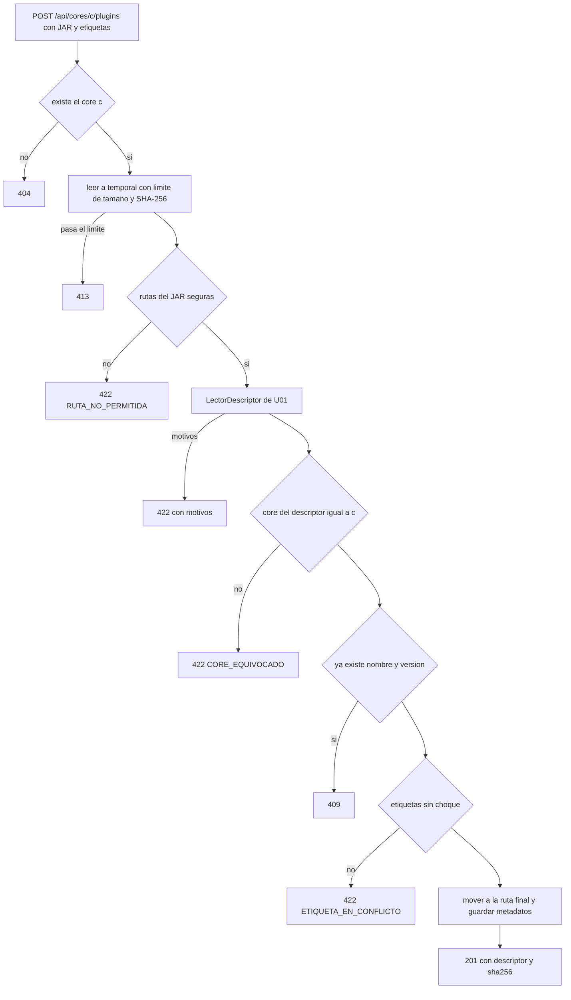

# U04 · Modelo de lógica (Catálogo)

## Subida de un plugin

_Texto alternativo:_ la subida comprueba en orden que el core existe, el tamaño, las rutas del
JAR, el descriptor, que el descriptor sea de ese core, que no exista ya esa versión y que las
etiquetas no choquen. Solo si todo pasa, el archivo temporal se mueve a su ruta final y se
guardan los metadatos. Cada fallo tiene su código.

## Interfaz pública del módulo (`catalogo.api`)

`registrarCore`, `obtenerCore`, `subirPlugin`, `listarPlugins`, `obtenerPlugin`,
`abrirArtefacto(sha256)`, y la implementación de `Catalogo` de U01 (`versionesCore`,
`versionesPlugin`, `descriptor`) que usa U07.

## Cumplimiento

AUTONOMIA-01: N/A (no toca el clúster). AUTONOMIA-02: cada regla R-C tiene su prueba y su `curl`
en el plan de tareas. PBT parcial: la comprobación de rutas del JAR (R-C6) admite una propiedad
"ninguna entrada aceptada resuelve fuera del directorio" (PBT-03).
