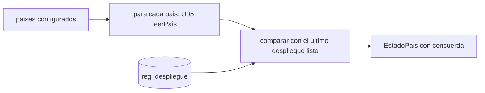

# U06 · Modelo de lógica (Registro)

## Vista general (S7)

_Texto alternativo:_ por cada país configurado se lee del clúster lo que corre (con U05) y se
compara con su último despliegue `listo` del registro; el resultado es el estado del país con la
marca de concordancia.

## Interfaz pública (`registro.api`)

`registrar`, `actualizarResultado`, `obtener`, `historial(pais)`, `ultimoListo(pais)`,
`vistaGeneral()`. Rutas propias: `GET /api/paises`, `GET /api/paises/{pais}/despliegues`,
`GET /api/despliegues/{id}` (lectura).

## Cumplimiento

AUTONOMIA-01: cumple (U06 solo lee del clúster). AUTONOMIA-02: R-R1 a R-R8 se prueban con
`./gradlew :backend:test --tests '*registro*'` y `sqlite3`. PBT: N/A (sin funciones puras
relevantes más allá de la comparación, cubierta por casos).
