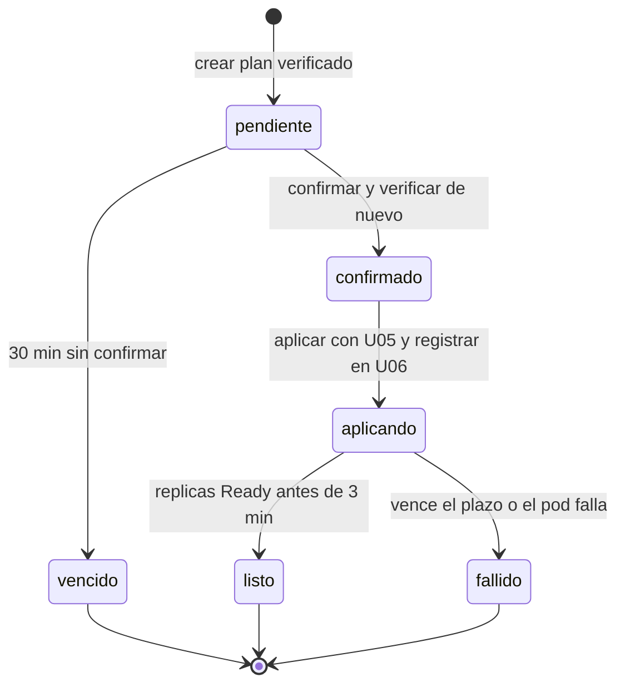

# U07 · Modelo de lógica (Despliegue)

## Estados del plan y del despliegue

_Texto alternativo:_ un plan nace `pendiente`; vence a los 30 minutos o se confirma (con una
nueva verificación). Al confirmarse, el despliegue pasa a `aplicando` y termina en `listo` o en
`fallido`. Desde ningún estado final se vuelve atrás de forma automática: la reversión es un plan
nuevo.

## Interfaz pública y rutas

`verificar`, `prepararPlan`, `confirmar`, `prepararReversion`, `obtenerPlan`. Rutas:
`POST /api/verificaciones`, `POST /api/despliegues`, `POST /api/despliegues/{id}/confirmacion`,
`POST /api/despliegues/{id}/reversion`.

## Cumplimiento

| Regla | Estado |
|---|---|
| AUTONOMIA-01 | Cumple: R-D5 a R-D7 y R-D13 hacen de la confirmación el único camino a `aplicar`; R-D10 y R-D11 prohíben reintentos y reversiones automáticas; R-D1 impide elegir el namespace |
| AUTONOMIA-02 | Cumple: cada regla se prueba con `./gradlew :backend:test --tests '*despliegue*'` sobre el servidor simulado de Fabric8 |
| PBT parcial | El cálculo de cambios (R-D4) admite la propiedad "aplicar los cambios a lo que corre da la selección" (PBT-03) |
