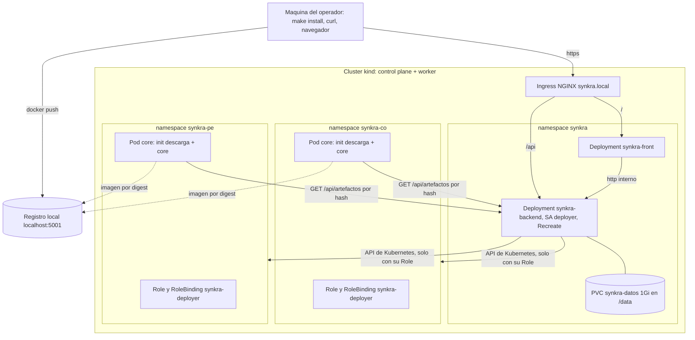

# U08 · Arquitectura de despliegue

_Texto alternativo:_ desde la máquina del operador se instala y se usa SynKra por el Ingress
`synkra.local`, que manda `/` al front y `/api` al backend, ambos en el namespace `synkra`. El
backend monta el PVC y usa la cuenta `deployer`, que solo tiene un `Role` en `synkra-co` y en
`synkra-pe`. Los pods de cada país descargan sus plugins del backend por hash y su imagen del
registro local por digest.

## Orden de `make install`

1. `kind create cluster --config deploy/kind/cluster.yaml` (si no existe) y el registro local.
2. Ingress NGINX para `kind`; certificado autofirmado para `synkra.local`.
3. `docker build` y `docker push` del backend, el core y el init container (y el front si existe).
4. `kubectl apply -k deploy/overlays/kind`.
5. `kubectl wait` hasta que el backend esté listo.
6. `make verificar-limite`.
