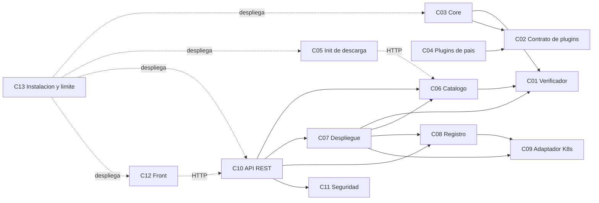

# Dependencias entre componentes: SynKra

"A depende de B" significa que A usa B en compilación o lo llama en ejecución. Las flechas van
del que usa al usado.

## Matriz

| Componente | Depende de | Tipo | Comunicación |
|---|---|---|---|
| C01 Verificador | ninguno | | |
| C02 Contrato de plugins | ninguno | | |
| C03 Core | C01, C02 | Compilación | Llamada Java en proceso |
| C04 Plugins de país | C02 | Compilación | El core los carga por `ServiceLoader` |
| C05 Init de descarga | C06 | Ejecución | HTTP `GET /api/artefactos/{sha256}` desde `synkra-<país>` |
| C06 Catálogo | C01 | Compilación | Llamada Java en proceso |
| C07 Despliegue | C01, C06, C08, C09 | Compilación | Llamadas Java dentro del backend |
| C08 Registro | C09 | Compilación | Llamada Java (lectura del clúster) |
| C09 Adaptador de Kubernetes | ninguno (Fabric8) | | API de Kubernetes con la cuenta `synkra:deployer` |
| C10 API REST | C06, C07, C08, C11 | Compilación | Llamadas Java |
| C11 Seguridad | ninguno | | |
| C12 Front | C10 | Ejecución | HTTP desde el servidor Blazor |
| C13 Instalación y límite | C03, C05, C10, C12 | Despliegue | Construye y despliega sus imágenes |

**Recursos compartidos:** C06, C07, C08 y C11 comparten el archivo SQLite del PVC dentro de un
solo proceso (una réplica, RNF-07); cada uno es dueño de sus tablas y no lee las de otro
directamente. C01 se comparte como **librería**, no como servicio: el backend y el core la
empaquetan, y la suite viaja en sus `testFixtures`.

## Grafo



_Texto alternativo:_ el verificador (C01), el contrato de plugins (C02), el adaptador de
Kubernetes (C09) y la seguridad (C11) no dependen de nada. El core usa C01 y C02; los plugins usan
C02. El catálogo usa C01. El registro usa C09. El despliegue usa C01, C06, C08 y C09. La API usa
C06, C07, C08 y C11. El front llama a la API por HTTP, el init container llama al catálogo por
HTTP, y la instalación despliega el core, el init container, el backend y el front.

## Sin ciclos: verificado con un script

Dos dependencias que se veían naturales habrían formado ciclos y se rompieron en el diseño:

| Ciclo evitado | Cómo se rompió |
|---|---|
| Despliegue ↔ Registro (el despliegue escribe en el registro y la reversión lee el registro para crear un plan) | La reversión es un servicio de **C07** que lee C08; C08 nunca llama a C07 |
| Despliegue ↔ Registro por el clúster (los dos necesitan leer Kubernetes) | El acceso al clúster sale a **C09**, del que dependen ambos |

Comprobación con `scripts/verificar-grafo.py` (orden topológico de Kahn sobre la matriz de arriba; salida real):

```text
$ python3 scripts/verificar-grafo.py aidlc-docs/inception/application-design/component-dependency.md
13 nodos, 19 dependencias
Orden topologico: C01 C02 C03 C04 C06 C05 C09 C08 C07 C11 C10 C12 C13
Sin ciclos: OK
```

## Flujo de datos

| Dato | Nace en | Pasa por | Termina en |
|---|---|---|---|
| JAR del plugin | P-PUB (subida) | C10 → C06 (valida con C01) | PVC `/data/artefactos/…`; después `/plugins` del pod vía C05 |
| Descriptor | Dentro del JAR | C01 en C06 (al subir) y C01 en C03 (al arrancar) | Metadatos en SQLite |
| Plan | C07 | SQLite (`pendiente`) | Se confirma o queda abandonado (H-17) |
| Objetos del país | C09 `construir` | API de Kubernetes | `synkra-<país>` |
| Resultado y contexto | C07 S5 con C09 | C08 | SQLite; detalle en el front |
