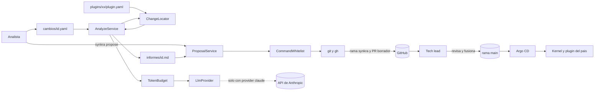

# Dependencias entre componentes — SynKra

## Matriz de dependencias en tiempo de compilación

`X` = el componente de la fila depende del de la columna.

| Depende de → | C1 core | C2 co | C3 pe | C4 agent | C5 eval | C6 deploy |
|---|---|---|---|---|---|---|
| **C1 core** | — | | | | | |
| **C2 plugins/co** | X (JAR plano) | — | | | | |
| **C3 plugins/pe** | X (JAR plano) | | — | | | |
| **C4 agent** | X (solo modelo del manifiesto) | | | — | | |
| **C5 eval** | | | | lee su salida (informes) | — | |
| **C6 deploy** | | | | | | — |

Reglas:
- **C1 no depende de nadie** (P2). Ninguna flecha sale de `core` hacia un plugin.
- **C2 y C3 no dependen entre sí** (RF-13). Su única dependencia es el JAR plano de `core`.
- **C4 no depende de C2 ni C3 como código.** Los lee como datos (`plugins/*/plugin.yaml`).
- **C5 depende de C4 solo por sus archivos de salida.** No importa código del agente.

## Dependencias en tiempo de ejecución

| Origen | Destino | Cómo | Cuándo |
|---|---|---|---|
| Kernel (pod) | JAR de plugin | `ServiceLoader` sobre un cargador de clases único, desde el volumen `/plugins` | Arranque |
| Init container | Volumen `/plugins` | Copia el JAR del plugin del país | Antes del arranque del kernel |
| Agente | Repositorio local | Lee `plugins/*/plugin.yaml` y archivos de evidencia | `analyze` y `propose` |
| Agente | `git` y `gh` | Procesos tras `CommandWhitelist` | Solo `propose` |
| Agente | GitHub (repo `Jacarrilloc/SynKra`) | Vía `git push` y `gh pr create --draft` con `$AGENT_TOKEN` | Solo `propose` |
| Agente | API de Anthropic | Adaptador `claude` | Solo con `LLM_PROVIDER=claude` y presupuesto disponible |
| Argo CD | Repositorio | Lee `deploy/overlays/xx` | Reconciliación |
| Humano | `main` | Revisa y fusiona el PR | Fuera del agente |

## Flujo de datos



### Alternativa en texto

```
Analista -> cambios/<id>.yaml -> AnalyzeService
AnalyzeService + plugins/*/plugin.yaml -> ChangeLocator (decide, determinista)
AnalyzeService -> TokenBudget -> LlmProvider -> (API de Anthropic solo si provider=claude)
AnalyzeService -> informes/<id>.md
Analista ejecuta "synkra propose <id>" -> ProposalService (lee informes/<id>.md)
ProposalService -> CommandWhitelist -> git y gh -> GitHub (rama synkra/<id>, PR en borrador)
GitHub -> Tech lead (revisa y fusiona en main)
main -> Argo CD -> Kernel y plugin del país
```

El único tramo que cruza el perímetro es el del `LlmProvider` con el adaptador `claude` hacia la
API de Anthropic (NFR-09). La decisión de qué plugin tocar nunca sale de `ChangeLocator`.

## Fronteras de confianza y límite de autonomía

| Frontera | Qué la hace cumplir | Historia |
|---|---|---|
| El agente no escribe en `main` | Protección de rama en GitHub + token solo para `synkra/*` + `CommandWhitelist` | US-1.9, US-1.10 |
| El agente no fusiona ni aprueba | Permisos del token + ausencia de camino de código | US-1.11 |
| El agente no escribe en el clúster | ServiceAccount `agent` sin permisos de escritura | US-1.12 |
| El texto del cambio es dato | El localizador no lee texto libre para decidir; el modelo solo redacta | US-4.2 |
| El gasto de IA está acotado | `TokenBudget` antes de cada llamada | US-4.3 |
| Las pruebas no llaman a la API | `LLM_PROVIDER=fake` y red bloqueada | US-4.4 |

## Riesgos de acoplamiento identificados

1. **Agente y `core`.** El agente arrastra Spring Boot en su classpath por depender del JAR
   plano de `core` (F2-B). Mitigación: `core` publica un JAR plano sin repackage, y el agente
   usa solo `com.synkra.core.manifest`. Se revisa en NFR Design del agente.
2. **Agente que ve el repositorio.** `analyze` y `propose` asumen ejecución en la raíz del
   repositorio clonado. En el Job de Kubernetes hay que montar o clonar el repositorio; se
   decide en Infrastructure Design.
3. **Un cargador de clases único (Q3-B).** Si dos plugins cargaran clases con el mismo nombre
   completo, chocarían. Con un país activo por kernel no ocurre en producción, pero sí en
   pruebas de integración con ambos JAR. Se cubre con una prueba en `core`.
