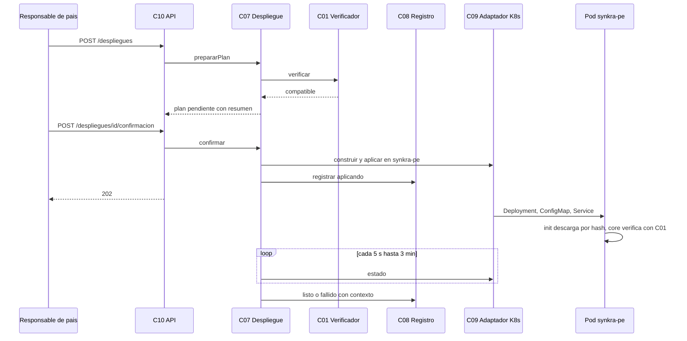

# Servicios: SynKra

Los servicios orquestan componentes; viven en el backend (C06 a C09) salvo el arranque del core.
Todos los que cambian el clúster pasan por una confirmación humana (AUTONOMIA-01).

| Servicio | Componente | Orquesta | Disparador | Historias |
|---|---|---|---|---|
| S1 Ingreso de compilados | C06 | C01 (descriptor) → disco del PVC → SQLite | `POST …/plugins` | H-02 a H-04 |
| S2 Verificación en vivo | C07 | C06 (lo disponible) → C01 (veredicto y alternativas) | `POST /api/verificaciones` | H-08, H-09 |
| S3 Preparación de plan | C07 | validar país (S4) → S2 → C08 (lo que corre hoy, para los cambios) → plan `pendiente` en SQLite | `POST /api/despliegues` | H-11, H-13, H-17 |
| S4 Confirmación | C07 | plan `pendiente` → C09 `construir` + `aplicar` → C08 `registrar` (`aplicando`) → lanza S5 | `POST …/confirmacion` | H-12 |
| S5 Vigilancia | C07 | C09 `estado` cada 5 s hasta 3 min → C08 `actualizarResultado`; si falla, C09 `contextoFallo` | Asíncrono tras S4 | H-14, H-16 |
| S6 Reversión | C07 | C08 `obtener(origen)` → S3 con esa combinación y tipo `reversion` | `POST …/reversion` | H-20 |
| S7 Vista general | C08 | C09 `leerPais` por cada país configurado → compara con el último despliegue del registro | `GET /api/paises` | H-19 |
| S8 Arranque del core | C03 | `/config/plugins-activos.yaml` → C01 por cada plugin → cargador por plugin → `iniciar` → readiness | Arranque del pod | H-21, H-22 |

## Flujo de un despliegue (S3 → S4 → S5)

_Texto alternativo:_ el responsable de país crea el plan; el despliegue lo verifica con el
verificador y devuelve un plan pendiente. Al confirmar, el adaptador aplica los objetos en
`synkra-pe`, el registro anota `aplicando` y la API responde 202. En el pod, el init container
descarga los plugins por hash y el core los verifica. El servicio de vigilancia consulta el
estado cada 5 segundos hasta 3 minutos y deja `listo` o `fallido` en el registro.

## Lo que ningún servicio hace

- Ningún servicio reintenta un despliegue, revierte por su cuenta ni aplica un plan sin
  confirmar (P2, AUTONOMIA-01).
- Ningún servicio crea namespaces (S1): existen desde la instalación.
