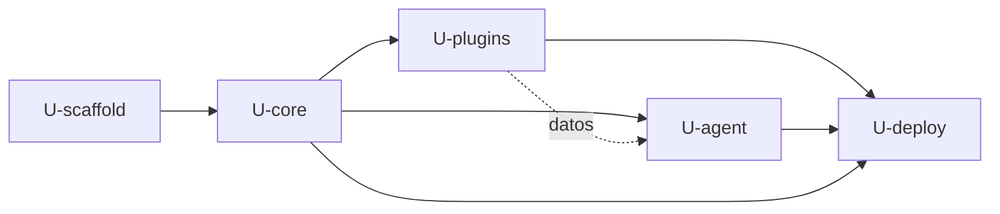

# Dependencias entre unidades — SynKra

## Matriz de dependencias

`D` = dependencia dura (el código o el artefacto de la fila no se puede construir sin la columna).
`d` = dependencia de datos (usa archivos de la otra unidad; puede arrancar con fixtures).

| Depende de → | U-scaffold | U-core | U-plugins | U-agent | U-deploy |
|---|---|---|---|---|---|
| **U-scaffold** | — | | | | |
| **U-core** | D (pom raíz) | — | | | |
| **U-plugins** | D | D (JAR plano de `core`) | — | | |
| **U-agent** | D | D (modelo del manifiesto) | d (manifiestos reales; dataset y `propose`) | — | |
| **U-deploy** | D | D (imagen del kernel) | D (JAR para la imagen `synkra/plugins`) | D (CLI del Job y ServiceAccount) | — |

Sin ciclos: el grafo es un DAG.



Alternativa en texto:

```
U-scaffold  precede a  U-core
U-core      precede a  U-plugins, U-agent, U-deploy
U-plugins   precede a  U-deploy  (y alimenta de datos a U-agent)
U-agent     precede a  U-deploy
```

## Orden de construcción y paralelismo (Q5-B: dos personas)

| Ola | Unidades | Condición |
|---|---|---|
| 0 | U-scaffold | Ninguna |
| 1 | U-core | U-scaffold terminada |
| 2 | **U-plugins** y **U-agent** en paralelo | El diseño funcional de U-core (contratos y manifiesto) está aprobado; no hace falta su código. U-agent usa fixtures de manifiesto hasta que existan los reales |
| 3 | U-deploy | U-plugins y U-agent terminadas |

Dentro de la ola 2, `U-agent` empieza por sus tareas de límite de autonomía (protección de
`main`, token), que no dependen de ninguna otra unidad.

**Orden de planificación (Q4):** `U-scaffold`, `U-core`, `U-plugins`, `U-agent`, `U-deploy`.
Es el orden en que se escriben los planes en este trabajo; el paralelismo de la tabla anterior
aplica a la ejecución futura del código.

## Contratos entre unidades

| Origen | Destino | Contrato | Cómo se verifica |
|---|---|---|---|
| U-core | U-plugins | Interfaces de extensión y modelo del manifiesto (JAR plano) | `mvn -pl plugins/co,plugins/pe test` |
| U-core | U-agent | Modelo del manifiesto (`com.synkra.core.manifest`) | Prueba de que el agente lee los `plugin.yaml` reales |
| U-plugins | U-agent | `plugin.yaml` y directorio `changes/` | Dataset de evaluación; prueba de `propose` en un repositorio temporal |
| U-core, U-plugins | U-deploy | JAR del kernel y JAR de los plugins | `docker build` de las dos imágenes |
| U-agent | U-deploy | CLI empaquetado y ServiceAccount `agent` (`deploy/agent-identity/`) | `kubectl get job` y `kubectl auth can-i` |

## Rutas por propietario (sin edición cruzada)

| Ruta | Propietario | Quién la consume |
|---|---|---|
| `pom.xml`, `Makefile` (`build`, `test`), `.gitignore` | U-scaffold | Todas |
| `Makefile` (`images`, `deploy`, `status`) | U-deploy | Personas |
| `core/` | U-core | U-plugins, U-agent, U-deploy |
| `plugins/` | U-plugins | U-agent, U-deploy |
| `agent/`, `eval/`, `scripts/configure-github.sh`, `deploy/agent-identity/` | U-agent | U-deploy |
| `images/`, `deploy/base`, `deploy/overlays`, `deploy/security`, `deploy/gitops`, `deploy/agent-job` | U-deploy | Argo CD |
| `README.md` | Esqueleto: U-scaffold. Sección "perímetro": U-agent | Todas |

El `Makefile` y el `README.md` son los únicos archivos con dos propietarios; cada unidad edita
solo sus objetivos o su sección.

## Validación de fronteras

| Comprobación | Resultado |
|---|---|
| Sin ciclos de dependencia | Cumple (DAG) |
| Ninguna historia huérfana | Cumple (ver `unit-of-work-story-map.md`: 37 de 37) |
| Cada requisito Must y Should cubierto por al menos una unidad | Cumple (ver cobertura en el mapa de historias) |
| AUTONOMIA-01: ninguna unidad da al agente `merge`, `push` a `main`, `kubectl apply` ni `helm install` | Cumple. `U-agent` solo escribe en `synkra/*` y abre PR en borrador; `U-deploy` aplica manifiestos mediante personas o Argo CD, nunca mediante el agente |
| AUTONOMIA-01: existe una unidad con tarea que comprueba el límite con comandos | `U-agent` (US-1.9 a US-1.12) |
| AUTONOMIA-02: todo uso de modelo pasa por `LlmProvider` y hay prueba de presupuesto 0 | `U-agent` (US-1.5, US-4.3, US-4.4) |
| Ruta compartida editada por dos unidades | Solo `Makefile` y `README.md`, con reparto explícito |
