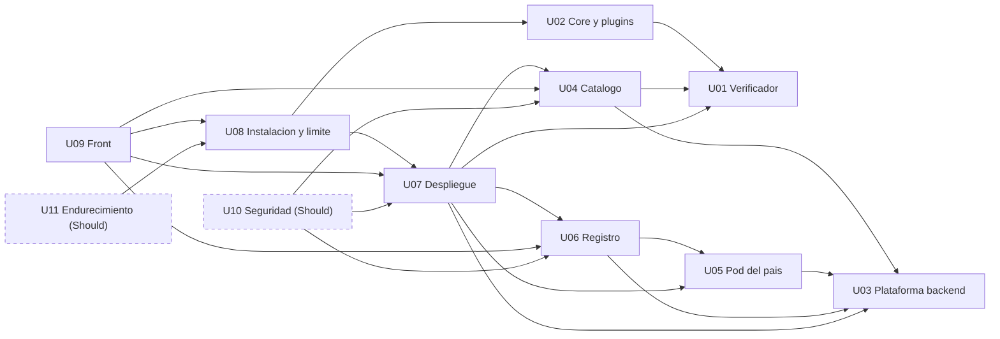

# Dependencias entre unidades: SynKra

"A depende de B" = A no se puede terminar sin el resultado de B (código que usa, o artefacto que
despliega). Una dependencia de prueba con un doble (por ejemplo, U06 con U05 simulado) no cuenta
para empezar, pero sí para terminar.

## Matriz

| Unidad | Depende de | Por qué |
|---|---|---|
| U01 Verificador y suite | ninguna | Librería pura |
| U02 Core, contrato y plugins | U01 | El core verifica con la librería y corre la suite |
| U03 Plataforma del backend | ninguna | Aplicación vacía |
| U04 Catálogo | U01, U03 | Lee descriptores con U01; vive en la aplicación de U03 |
| U05 Pod del país | U03 | Vive en la aplicación de U03; el init container se prueba con un servidor HTTP local |
| U06 Registro y vista general | U03, U05 | Lee el clúster con U05 |
| U07 Despliegue y reversión | U01, U03, U04, U05, U06 | Verifica con U01, lee el catálogo, aplica con U05, registra en U06 |
| U08 Instalación y límite | U02, U07 | Despliega el backend completo y necesita la imagen del core para el punta a punta |
| U09 Front | U04, U06, U07, U08 | Consume sus rutas; su manifiesto se suma a la instalación |
| U10 Seguridad y roles | U04, U06, U07 | Protege sus rutas |
| U11 Endurecimiento y entrega | U08 | Endurece la instalación |

## Grafo



_Texto alternativo:_ U01 y U03 no dependen de nada. U02 depende de U01. U04 depende de U01 y U03.
U05 depende de U03. U06 depende de U03 y U05. U07 depende de U01, U03, U04, U05 y U06. U08 depende
de U02 y U07. U09 depende de U04, U06, U07 y U08. Las Should: U10 depende de U04, U06 y U07; U11
depende de U08.

## Sin ciclos: verificado con un script

Salida real:

```text
$ python3 scripts/verificar-grafo.py aidlc-docs/inception/application-design/unit-of-work-dependency.md
11 nodos, 21 dependencias
Orden topologico: U01 U02 U03 U04 U05 U06 U07 U08 U09 U10 U11
Sin ciclos: OK
```

## Paralelismo

Unidades que no dependen la una de la otra (ni directa ni transitivamente) y se pueden construir
a la vez:

| Pareja o grupo | Por qué |
|---|---|
| **U01 y U03** | Las dos raíces del grafo: ninguna depende de nada |
| **U02, U04 y U05** | Tras U01 y U03; ninguna de las tres depende de las otras |
| **U02 y U06** | El core no sabe nada del registro |
| **U09 y U10** | El front y la seguridad solo comparten las rutas que ya existen |
| **U10 y U11** | Las dos Should son independientes |

## Orden de construcción (Q7)

| Ola | Unidades | Resultado al terminar la ola |
|---|---|---|
| 1 | U01, U03 | La regla de compatibilidad y la aplicación vacía |
| 2 | U02, U04, U05 | Core que no arranca con un plugin incompatible; catálogo con `curl`; objetos del país |
| 3 | U06, U07 | Despliegue confirmado, vigilado y registrado (contra el servidor simulado) |
| 4 | U08, luego U09 | **Demo de punta a punta en `kind`**, primero con `curl` (P5) y luego desde el front |
| 5 | U10, U11 | Should: roles, políticas, Trivy, GitOps. Se cortan si no hay tiempo |

**Camino crítico:** U03 → U05 → U06 → U07 → U08 → U09. U01 va en paralelo y llega a U07 por dos
caminos (directo y vía U04), así que un retraso en el verificador también lo frena: por eso es la
primera unidad de la ola 1 (R1).

**Si falta tiempo (R9):** se cortan U11, luego U10, y la demo se hace con `curl` si U09 no
llega (R8). U01 a U08 son el mínimo que demuestra la North Star.
