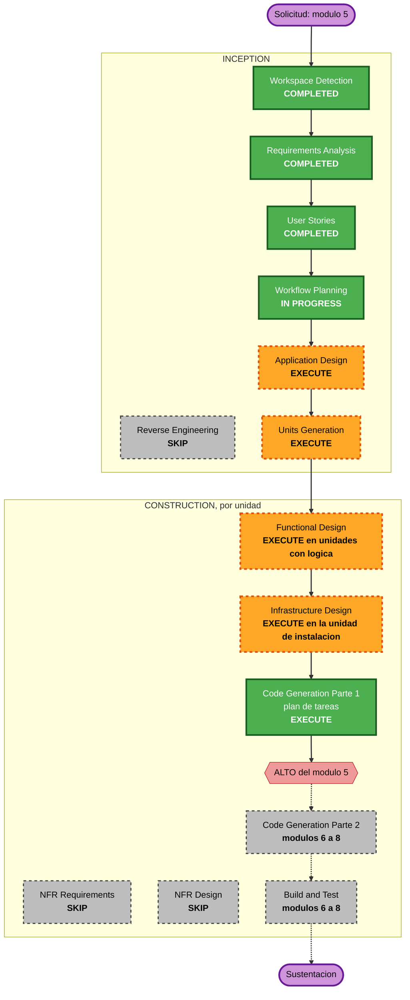

# Plan de ejecución: SynKra

**Entradas:** `requirements.md` (aprobado), `stories.md` y `personas.md` (aprobados), PRD v2 §12
(riesgos) y §13 (plan de entrega).
**Límite del módulo 5:** el flujo se detiene al terminar la **Parte 1 de Code Generation** de cada
unidad (planes de tareas). La Parte 2 (código) y Build and Test corren en los módulos siguientes
con el loop de agentes.

---

## Análisis

### Impacto del cambio
- **Cambios visibles para el usuario:** sí. Front de 4 pantallas y API REST con 4 roles
- **Cambios estructurales:** sí. Sistema nuevo: backend, librería de verificación compartida,
  core con carga de plugins, init container, front y la instalación en el clúster
- **Modelo de datos:** sí. Catálogo (cores, versiones, plugins, etiquetas, hash), planes y
  registro de despliegues, usuarios con rol; en SQLite
- **API:** sí. API REST nueva, base de la CLI futura (P5)
- **NFR:** sí, acotados. Seguridad en el clúster (RBAC, P2), persistencia con una réplica, metas
  de tiempo **[INTERNO]**; ya enunciados en `requirements.md` §5

### Riesgo
- **Nivel:** medio. Es un ejercicio académico en `kind`, pero SynKra escribe en el clúster (R3) y
  hay dos stacks (R8)
- **Vuelta atrás:** fácil en el demo (borrar el clúster `kind`); dentro del producto, la reversión
  es un requisito (RF-22)
- **Complejidad de prueba:** moderada. La suite de combinaciones es unitaria; los despliegues
  necesitan `kind`

### Riesgos del PRD §12 que cambian el plan
| Riesgo | Efecto en el plan |
|---|---|
| R1 motor y core no coinciden | La librería de verificación es la primera unidad y no depende de nada: el backend y el core la consumen, no la copian |
| R9 el alcance no cabe | Los Must van primero en el orden de unidades; las Should (E8) quedan en unidades o tareas separadas que se pueden cortar. Las etapas de diseño de Construction se hacen solo donde hay lógica que diseñar |
| R8 dos stacks | El front es una unidad aparte, al final, que solo depende del contrato de la API: si falta tiempo, la demo se hace con `curl` |
| R3 permisos de escritura | La instalación y el RBAC son una unidad propia con diseño de infraestructura, no un detalle del backend |

---

## Visualización del flujo

_Texto alternativo:_ INCEPTION ya completó Workspace Detection, Requirements Analysis y User
Stories, y omitió Reverse Engineering. Siguen Application Design y Units Generation. En
CONSTRUCTION, por cada unidad, se hace Functional Design solo donde hay lógica, Infrastructure
Design solo en la unidad de instalación, y la Parte 1 de Code Generation. Ahí se detiene el
módulo 5; la Parte 2 y Build and Test quedan para los módulos 6 a 8.

---

## Etapas

### 🔵 INCEPTION
- [x] Workspace Detection (COMPLETED)
- [x] Reverse Engineering (SKIPPED: greenfield)
- [x] Requirements Analysis (COMPLETED)
- [x] User Stories (COMPLETED)
- [x] Workflow Planning (IN PROGRESS)
- [ ] **Application Design: EXECUTE**
  - **Razón:** hay componentes nuevos (catálogo, verificador, motor de despliegue, registro, core,
    init container, front) cuyos métodos, servicios y dependencias hay que definir, y hay que fijar
    la frontera dentro/fuera del clúster y la persistencia. Es el prerrequisito de Units Generation
- [ ] **Units Generation: EXECUTE**
  - **Razón:** el sistema tiene varios artefactos desplegables y una librería compartida; el
    entregable del módulo 5 son las unidades y sus tareas

### 🟢 CONSTRUCTION (por unidad, hasta la Parte 1 de Code Generation)
- [ ] **Functional Design: EXECUTE, solo en las unidades con lógica de negocio**
  - **Razón:** las reglas de compatibilidad (rangos, alternativas), la lectura y validación del
    descriptor, los estados del despliegue (`pendiente`, `aplicando`, `listo`, `fallido`) y el
    modelo de datos del registro necesitan diseño antes de escribir tareas. Se omite en las
    unidades sin lógica propia (front, instalación), que se declaran en Units Generation
- [ ] **NFR Requirements: SKIP**
  - **Razón:** los NFR ya están enunciados en `requirements.md` §5 con sus metas, y el stack está
    decidido (Java 21 / Spring Boot, Blazor, SQLite, Fabric8). Repetirlo no añade decisiones
- [ ] **NFR Design: SKIP**
  - **Razón:** sin NFR Requirements no hay patrones nuevos que materializar; los pocos patrones
    necesarios (una réplica con `Recreate`, reintentos acotados del init container, cargador de
    clases por plugin) ya están en los requisitos y se detallan en Functional Design
- [ ] **Infrastructure Design: EXECUTE, solo en la unidad de instalación y límite**
  - **Razón:** los manifiestos de SynKra, el RBAC de `synkra:deployer`, el PVC, los namespaces de
    los países (supuesto S1) y la plantilla del pod del país con su init container son el punto
    donde P2 se vuelve verificable (R3)
- [ ] **Code Generation Parte 1: EXECUTE en todas las unidades** (plan de tareas numerado, con
  casillas, trazado a historias y con criterio por comando)
- [ ] Code Generation Parte 2: **NO se ejecuta en el módulo 5**
- [ ] Build and Test: **NO se ejecuta en el módulo 5**

### 🟡 OPERATIONS
- [ ] Operations: PLACEHOLDER. La instalación de SynKra con GitOps (H-34, Should) es del módulo 8

---

## Plazo

- **Etapas restantes del módulo 5:** Workflow Planning, Application Design, Units Generation y,
  por unidad, Functional Design (donde aplique), Infrastructure Design (una unidad) y la Parte 1
  de Code Generation; después, `unidades-y-tareas.md` y `DECISIONES.md`.
- **Construcción (fuera de este paso):** la sustentación es la semana siguiente al 21-nov-2026
  **[VERIFICAR fecha exacta]**. El PRD §13 repartía la construcción entre los módulos 4 a 8; en la
  práctica empieza después de este paso. Por eso el orden de unidades pone primero lo que da una
  demo de punta a punta con los Must (R9).

## Criterios de éxito

- **Objetivo:** unidades de trabajo con fronteras reales y planes de tareas verificables, listos
  para el loop de agentes.
- **Entregables:** los artefactos de la guía del módulo 5, §13: requisitos, historias, este plan,
  los cinco artefactos de Application Design, los tres de Units Generation, los planes de tareas
  por unidad, `unidades-y-tareas.md`, `DECISIONES.md` y la bitácora.
- **Compuertas de calidad:** grafo de unidades sin ciclos, verificado con un script; toda historia
  asignada a una unidad; al menos dos unidades sin dependencias entre sí; cada tarea con criterio
  por comando (AUTONOMIA-02); ninguna tarea que aplique cambios a un clúster compartido sin
  aprobación (AUTONOMIA-01); **cero código de aplicación**.

## Cumplimiento de extensiones

| Regla | Estado | Motivo |
|---|---|---|
| AUTONOMIA-01 | Cumple | El plan no ejecuta nada sobre un clúster: se detiene en los planes de tareas. Infrastructure Design se hace sobre la unidad donde vive el límite |
| AUTONOMIA-02 | Cumple | Las compuertas de calidad exigen criterio por comando en cada tarea |
| PBT parcial | N/A en esta etapa | Se aplica en el Functional Design y en las tareas del verificador |
