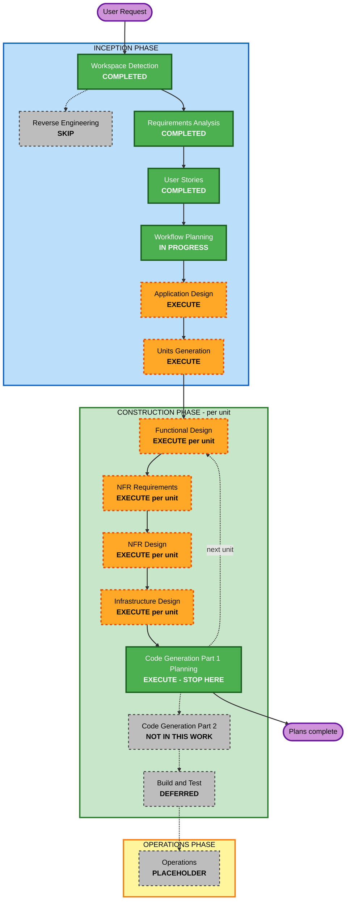

# Execution Plan — SynKra

## Detailed Analysis Summary

### Transformation Scope (Brownfield Only)
No aplica: proyecto greenfield.

### Change Impact Assessment
- **User-facing changes**: Sí. CLI del agente (`synkra analyze`, `synkra propose`), API REST de KYC, `make deploy COUNTRY=xx` y PRs en borrador (4 personas, 37 historias).
- **Structural changes**: Sí. Sistema nuevo: monorepo Maven multi-módulo (`core/`, `plugins/co`, `plugins/pe`, `agent/`, `deploy/`, `eval/`).
- **Data model changes**: Mínimo. El kernel es sin estado y sin base de datos (RF-05). Los datos son el YAML de cambio, el manifiesto de plugin, el informe de localización y el dataset de evaluación.
- **API changes**: Sí. Contrato de puntos de extensión (`DocumentValidator`, `ConsentPolicy`, `RetentionPolicy`), endpoints KYC, `/plugins`, health, puerto `LlmProvider`.
- **NFR impact**: Sí, alto. Límite de autonomía verificable, gasto de IA acotado, entrada no confiable, endurecimiento de pods, egress restringido.

### Component Relationships (Brownfield Only)
No aplica.

### Risk Assessment
- **Risk Level**: High. Un agente con acceso de escritura a ramas del repositorio, riesgo de inyección indirecta (R6) y falsos negativos silenciosos (R2).
- **Rollback Complexity**: Easy en el repositorio (todo es nuevo y vive en Git; los PR del agente son borradores). Moderate en el clúster (kind local; se destruye con `make cluster-delete`).
- **Testing Complexity**: Complex. Combina pruebas Java, manifiestos de Kubernetes, comandos contra GitHub y la API de GitHub, y un script Python de evaluación.

### Restricción del usuario sobre el alcance de este trabajo
El usuario pidió **no escribir código** y detener el trabajo **al terminar el plan de tareas de cada
unidad**. Eso se traduce así:

- Se ejecutan: Application Design, Units Generation y, por unidad, los diseños que apliquen y
  **Code Generation Part 1 (Planning)**.
- **No se ejecuta Code Generation Part 2 (Generation)** ni ninguna escritura de código.
- **Build and Test no se ejecuta** en este trabajo: depende de código existente. Queda diferido.
- El mensaje de cierre de Code Generation Part 1 normalmente ofrece "Continue to Next Stage", que
  llevaría a la Parte 2. En este trabajo, "Continue" significa **pasar a la siguiente unidad**.
  La Parte 2 queda fuera hasta que el usuario lo pida. Esta adaptación se confirma al aprobar este plan.

## Workflow Visualization



### Text Alternative

```
Phase 1: INCEPTION
- Workspace Detection ............ COMPLETED
- Reverse Engineering ............ SKIP (greenfield)
- Requirements Analysis .......... COMPLETED
- User Stories ................... COMPLETED
- Workflow Planning .............. IN PROGRESS
- Application Design ............. EXECUTE
- Units Generation ............... EXECUTE
Phase 2: CONSTRUCTION (per unit, then stop at the unit's task plan)
- Functional Design .............. EXECUTE per unit (where there is business logic)
- NFR Requirements ............... EXECUTE per unit (where NFRs drive the design)
- NFR Design ..................... EXECUTE per unit (follows NFR Requirements)
- Infrastructure Design .......... EXECUTE per unit (where there is deployment)
- Code Generation Part 1 (plan) .. EXECUTE, then STOP for that unit
- Code Generation Part 2 ......... NOT IN THIS WORK (no code)
- Build and Test ................. DEFERRED (needs code)
Phase 3: OPERATIONS ................ PLACEHOLDER
```

## Phases to Execute

### 🔵 INCEPTION PHASE
- [x] Workspace Detection (COMPLETED)
- [x] Reverse Engineering (SKIPPED: greenfield)
- [x] Requirements Analysis (COMPLETED)
- [x] User Stories (COMPLETED)
- [x] Workflow Planning (IN PROGRESS)
- [ ] Application Design - EXECUTE
  - **Rationale**: Hay componentes nuevos y sus dependencias deben fijarse antes de dividir en unidades: kernel, registro y carga de plugins, tres puntos de extensión, API KYC, plugins `co` y `pe`, agente (CLI, localizador determinista, generador de informe, abridor de PR), puerto `LlmProvider` con adaptadores `claude` y `fake`, control de presupuesto, evaluación.
- [ ] Units Generation - EXECUTE
  - **Rationale**: Varios módulos Maven más manifiestos de Kubernetes y un script Python. Se necesita una descomposición con dependencias y un mapa historia-a-unidad para que cada unidad tenga su plan de tareas.

### 🟢 CONSTRUCTION PHASE (por unidad)
- [ ] Functional Design - EXECUTE para unidades con lógica de negocio; SKIP para unidades solo de despliegue
  - **Rationale**: Hay reglas de negocio reales (localización determinista, reglas de país con fuente primaria, presupuesto). El despliegue puro (overlays) no tiene lógica de negocio que diseñar.
- [ ] NFR Requirements - EXECUTE para el agente y para la unidad de endurecimiento del clúster; SKIP para el resto
  - **Rationale**: Las NFR que cambian el diseño están ahí (inyección indirecta, presupuesto, egress, RBAC, Pod Security). La pila (Java 21, Spring Boot, Maven, Kustomize) ya está decidida en el PRD y las respuestas Q2 y Q3, así que no hay selección de tecnología que hacer en las demás unidades.
- [ ] NFR Design - EXECUTE donde se ejecutó NFR Requirements
  - **Rationale**: Sigue a NFR Requirements.
- [ ] Infrastructure Design - EXECUTE para despliegue, endurecimiento del clúster, GitOps y Job del agente; SKIP para kernel, plugins y evaluación
  - **Rationale**: Ahí hay Deployment, init container, NetworkPolicy, RBAC, Argo CD. Kernel y plugins no definen infraestructura propia.
- [ ] Code Generation Part 1 (Planning) - EXECUTE (ALWAYS), y el trabajo se detiene aquí en cada unidad
  - **Rationale**: Es el entregable final pedido. Cada plan lleva pasos con casillas y, por tarea, el comando que comprueba que terminó (AUTONOMIA-03).
- [ ] Code Generation Part 2 (Generation) - NOT IN THIS WORK
  - **Rationale**: El usuario pidió no escribir código.
- [ ] Build and Test - DEFERRED
  - **Rationale**: Necesita código construido; queda para un trabajo posterior.

### 🟡 OPERATIONS PHASE
- [ ] Operations - PLACEHOLDER
  - **Rationale**: Flujos de despliegue y monitoreo futuros.

## Package Change Sequence (Brownfield Only)
No aplica.

## Estimated Timeline
- **Total Phases**: 3 (Operations es placeholder)
- **Stages en este trabajo**: 2 de Inception (Application Design, Units Generation) y, por unidad, hasta 5 de Construction (4 de diseño condicionales y el plan de Code Generation). El número de unidades se fija en Units Generation.
- **Estimated Duration**: no se estima calendario: el trabajo depende de cuántas rondas de preguntas y aprobaciones haga falta. Cada etapa requiere una aprobación explícita.

## Success Criteria
- **Primary Goal**: Cada unidad termina con un plan de tareas aprobado, listo para generar código cuando el usuario lo pida.
- **Key Deliverables**: `application-design/`, `unit-of-work.md` con dependencias y mapa de historias, y por unidad: diseños aplicables y plan de Code Generation.
- **Quality Gates**:
  - AUTONOMIA-01: ningún plan contiene un paso del agente que ejecute `git merge`, `gh pr merge`, `git push` a `main`, `kubectl apply` ni `helm install`, y al menos una tarea comprueba `gh api repos/Jacarrilloc/SynKra/branches/main/protection` y `kubectl auth can-i create deployments --as=system:serviceaccount:synkra:agent -n synkra` (`no`).
  - AUTONOMIA-02: el uso de modelo pasa por `LlmProvider`; al menos una tarea comprueba que con presupuesto 0 el agente responde "presupuesto agotado" sin llamar a la API; la suite corre con `LLM_PROVIDER=fake`.
  - AUTONOMIA-03: toda tarea de todo plan nombra el comando o la prueba que demuestra que terminó.
  - Cada historia (37) queda asignada a una unidad, y cada RF/NFR Must y Should a al menos una tarea.
  - Ningún archivo de código se escribe.
