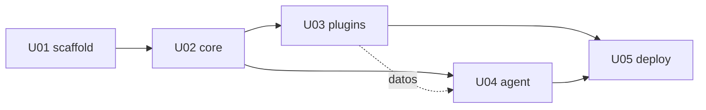

# Unidades y tareas — SynKra

> Consolidado de los planes de **Code Generation Parte 1** que produjo AI-DLC v1.0.1 y que
> se aprobaron unidad por unidad (`aidlc-docs/construction/plans/*-code-generation-plan.md`).
> Las tareas y sus comandos se copian tal cual de esos planes; este archivo no agrega trabajo.
> No hay código de aplicación: la Parte 2 de Code Generation no se ejecutó.

**5 unidades, 91 tareas.** Cada tarea trae el comando que demuestra que terminó (regla AUTONOMIA-03).
Las tareas marcadas **[PERSONA]** las ejecuta un humano, no el agente: tocan GitHub o el clúster
(regla AUTONOMIA-01).

## Orden de ejecución

Grafo sin ciclos (`aidlc-docs/inception/application-design/unit-of-work-dependency.md`):

| Ola | Unidades | Paralelismo |
|---|---|---|
| 1 | U01 | — |
| 2 | U02 | — |
| 3 | U03 y U04 | **En paralelo**: U04 solo usa datos de U03 y arranca con fixtures |
| 4 | U05 | — |

## U01 — U-scaffold: Estructura del monorepo

- **Responsabilidad:** Estructura del monorepo, `pom.xml` raíz, base del `Makefile` y README **No hace:** Historias, lógica y manifiestos de Kubernetes.
- **Depende de:** ninguna
- **Historias que implementa:** ninguna propia (sostiene a todas)
- **Plan fuente:** `aidlc-docs/construction/plans/U-scaffold-code-generation-plan.md` (10 tareas)

| # | Tarea | Criterio de aceptación (comando) | Historia |
|---|---|---|---|
| U01-T01 | `.gitignore` | `git check-ignore -q core/target && git check-ignore -q agent/logs/tokens.log && ! git check-ignore -q informes/2026-001.md && echo OK` imprime `OK`. | — |
| U01-T02 | `pom.xml` raíz | `mvn -q validate` termina en `0` y `mvn -q help:evaluate -Dexpression=maven.compiler.release -DforceStdout` imprime `21`. | — |
| U01-T03 | Variable `LLM_PROVIDER=fake` en la suite | `mvn -q help:effective-pom -Doutput=/tmp/effective-pom.xml && grep -c "LLM_PROVIDER" /tmp/effective-pom.xml` imprime un número mayor o igual que `1`. | — |
| U01-T04 | Módulos esqueleto | `mvn -q package -DskipTests` termina en `0` y `ls core/target/*.jar plugins/co/target/*.jar plugins/pe/target/*.jar agent/target/*.jar` lista cuatro archivos. | — |
| U01-T05 | Directorios de trabajo | `for d in eval deploy images cambios informes plugins/co/changes plugins/pe/changes; do test -d "$d" \|\| echo FALTA $d; done` no imprime nada. | — |
| U01-T06 | Objetivos `build` y `test` del `Makefile` | `make help \| grep -E "^ +(build\|test) "` imprime dos líneas y `make build && make test` termina en `0`. | — |
| U01-T07 | Herramientas de entorno (`python3` y `gh`) | `./scripts/doctor.sh \| grep -E "python3\|gh"` imprime dos líneas con `[ok]`. | — |
| U01-T08 | Esqueleto del `README.md` | `grep -c "SECCION: perimetro" README.md` imprime `1` y `grep -E "make build\|make test" README.md \| wc -l` imprime al menos `2`. | — |
| U01-T09 | Resumen de la unidad | `test -s aidlc-docs/construction/U-scaffold/code/summary.md && echo OK` imprime `OK`. | — |
| U01-T10 | Comprobación final de la unidad | `make doctor && make build && make test && git status --porcelain \| grep -vE "^\?\? (\.gitignore\|pom\.xml\|core/\|plugins/\|agent/\|eval/\|deploy/\|images/\|cambios/\|informes/\|aidlc-docs/)\|^ M (Makefile\|README.md\|scripts/)"` termina en `0` y la última parte no imprime nada. | — |

- **Terminada cuando:** `make doctor && make build && make test && git status --porcelain \| grep -vE "^\?\? (\.gitignore\|pom\.xml\|core/\|plugins/\|agent/\|eval/\|deploy/\|images/\|cambios/\|informes/\|aidlc-docs/)\|^ M (Makefile\|README.md\|scripts/)"` termina en `0` y la última parte no imprime nada.

## U02 — U-core: Kernel

- **Responsabilidad:** Kernel: contratos de extensión, modelo de manifiesto, cargador y registro de plugins, API de KYC
- **Depende de:** U01
- **Historias que implementa:** US-2.2, US-2.3, US-2.4, US-2.5
- **Plan fuente:** `aidlc-docs/construction/plans/U-core-code-generation-plan.md` (16 tareas)

| # | Tarea | Criterio de aceptación (comando) | Historia |
|---|---|---|---|
| U02-T01 | `core/pom.xml` | `mvn -q -pl core package -DskipTests && ls core/target/core-*-boot.jar core/target/core-0.1.0-SNAPSHOT.jar` lista los dos JAR, y `grep -nE "spring-boot-starter-data\|jdbc\|jpa" core/pom.xml` no imprime nada. | — |
| U02-T02 | Contratos de extensión y tipos (`spi`) | `grep -rlE "interface (DocumentValidator\|ConsentPolicy\|RetentionPolicy)" core/src/main \| wc -l` imprime `3` y `mvn -q -pl core compile` termina en `0`. | US-2.2 |
| U02-T03 | Modelo y lector del manifiesto (`manifest`) | `mvn -q -pl core test -Dtest=ManifestReaderTest` termina en `0` y `grep -h "Tests run" core/target/surefire-reports/*ManifestReaderTest.txt` muestra al menos 9 pruebas sin fallos. | US-2.8 |
| U02-T04 | Fixtures de plugins de prueba (`fixtures`) | `mvn -q -pl core test -Dtest=PluginJarBuilderTest` termina en `0` (la prueba construye cada variante y comprueba el contenido del JAR con `unzip -l` equivalente). | — |
| U02-T05 | Cargador de plugins (`plugin`) | `mvn -q -pl core test -Dtest=PluginLoaderTest` termina en `0`; la clase tiene una prueba por cada regla BR-L1 a BR-L8 (`grep -c "void .*BR_L" core/src/test/java/com/synkra/core/plugin/PluginLoaderTest.java` imprime al menos `8`). | US-2.3 |
| U02-T06 | Registro y resumen (`plugin`) | `mvn -q -pl core test -Dtest=PluginRegistryTest` termina en `0` e incluye la prueba de orden por `id` y la de registro vacío. | US-2.3 |
| U02-T07 | Configuración y validación de arranque (`config`) | `mvn -q -pl core test -Dtest=KernelPropertiesTest,KernelStartupFailureTest` termina en `0`, y `java -jar core/target/core-0.1.0-SNAPSHOT-boot.jar; echo $?` imprime un número distinto de `0` y una línea que contiene `synkra.country`. | — |
| U02-T08 | Guardia de país y API de KYC (`web`) | `mvn -q -pl core test -Dtest=CountryGuardTest,KycControllerTest` termina en `0`, con una prueba por cada código de error y una que comprueba que un documento inválido responde 200 con `valid:false`. | US-2.5 |
| U02-T09 | `GET /plugins` (`web`) | `mvn -q -pl core test -Dtest=PluginsControllerTest` termina en `0` con las pruebas «un plugin listado con tres puntos y versión», «lista vacía con directorio vacío» y «plugins de otro país también se listan». | US-2.3 |
| U02-T10 | Salud | `mvn -q -pl core test -Dtest=HealthTest` termina en `0`; con el JAR en marcha y un directorio de plugins vacío, `curl -s localhost:8080/actuator/health \| grep -c '"status":"UP"'` imprime al menos `1`. | US-2.4 |
| U02-T11 | Comprobación de independencia de país (NFR-02) | `mvn -q -pl core test -Dtest=NoCountryWordsTest` termina en `0` y `grep -rniE "colombia\|peru\|\bCO\b\|\bPE\b" core/src` no imprime nada (código de salida `1`). | US-2.2 |
| U02-T12 | Prueba de integración del kernel | `mvn -q -pl core verify` termina en `0` y `grep -h "Tests run" core/target/surefire-reports/*KernelIT.txt` muestra 0 fallos. | US-2.3, US-2.4, US-2.5 |
| U02-T13 | Sin estado ni persistencia (RF-05) | `mvn -pl core dependency:tree \| grep -ciE "jdbc\|jpa\|spring-data\|hibernate"` imprime `0`. | — |
| U02-T14 | Documentación del módulo | `grep -c "plugin.yaml" core/README.md` imprime al menos `1` y `grep -c "synkra.country" core/README.md` imprime al menos `1`. | — |
| U02-T15 | Resumen de la unidad | `test -s aidlc-docs/construction/U-core/code/summary.md && echo OK` imprime `OK`. | — |
| U02-T16 | Comprobación final de la unidad | `mvn -q -pl core verify && ! grep -rniE "colombia\|peru\|\bCO\b\|\bPE\b" core/src && git status --porcelain \| grep -vE "^( M\|\?\?) (core/\|aidlc-docs/)"` termina con la última parte sin imprimir nada. | — |

- **Terminada cuando:** `mvn -q -pl core verify && ! grep -rniE "colombia\|peru\|\bCO\b\|\bPE\b" core/src && git status --porcelain \| grep -vE "^( M\|\?\?) (core/\|aidlc-docs/)"` termina con la última parte sin imprimir nada.

## U03 — U-plugins: Plugins de país (CO y PE)

- **Responsabilidad:** Plugins `co` y `pe` con reglas reales y fuente primaria
- **Depende de:** U01, U02
- **Historias que implementa:** US-2.6, US-2.7, US-2.8, US-2.9, US-2.10
- **Plan fuente:** `aidlc-docs/construction/plans/U-plugins-code-generation-plan.md` (16 tareas)

| # | Tarea | Criterio de aceptación (comando) | Historia |
|---|---|---|---|
| U03-T01 | POM del agregador y de los plugins | `$PL -pl plugins/co,plugins/pe package -DskipTests` termina en `0` y `unzip -l plugins/pe/target/pe-*.jar \| grep -c "com/synkra/core/"` imprime `0` (y lo mismo con `co`). | US-2.10 |
| U03-T02 | Catálogo de reglas de Colombia | `$PL -pl plugins/co test -Dtest=ColombiaRuleSourceTest` termina en `0` y `grep -c "verificar=true" plugins/co/target/rules-report.txt` imprime `7`. | US-2.9 |
| U03-T03 | Validador de documento de Colombia | `$PL -pl plugins/co test -Dtest=ColombiaDocumentValidatorTest` termina en `0` con al menos 7 pruebas (`grep -h "Tests run" plugins/co/target/surefire-reports/*ColombiaDocumentValidatorTest.txt`). | US-2.6 |
| U03-T04 | Consentimiento y retención de Colombia | `$PL -pl plugins/co test -Dtest=ColombiaConsentPolicyTest,ColombiaRetentionPolicyTest` termina en `0`; la prueba de retención cubre las tres categorías. | US-2.6 |
| U03-T05 | Manifiesto, servicios y carga real de Colombia | `$PL -pl plugins/co test -Dtest=ColombiaManifestTest,ColombiaPluginLoadTest` termina en `0`. | US-2.6, US-2.8 |
| U03-T06 | Catálogo de reglas de Perú | `$PL -pl plugins/pe test -Dtest=PeruRuleSourceTest` termina en `0` y `grep -c "verificar=true" plugins/pe/target/rules-report.txt` imprime `7`. | US-2.9 |
| U03-T07 | Validador de documento de Perú | `$PL -pl plugins/pe test -Dtest=PeruDocumentValidatorTest` termina en `0` con al menos 7 pruebas. | US-2.7 |
| U03-T08 | Consentimiento y retención de Perú | `$PL -pl plugins/pe test -Dtest=PeruConsentPolicyTest,PeruRetentionPolicyTest` termina en `0`. | US-2.7 |
| U03-T09 | Manifiesto, servicios y carga real de Perú | `$PL -pl plugins/pe test -Dtest=PeruManifestTest,PeruPluginLoadTest` termina en `0`. | US-2.7, US-2.8 |
| U03-T10 | Independencia entre países (BR-I1, BR-I3) | `! grep -rniE "peru\|\bPE\b\|\bDNI\b" plugins/co/src && ! grep -rniE "colombia\|\bCO\b\|\bCC\b" plugins/pe/src && echo OK` imprime `OK`. | US-2.10 |
| U03-T11 | Empaquetado independiente | `mvn -q -pl plugins/co dependency:tree \| grep -c "plugins/pe\\|:pe:"` imprime `0`, igual para `pe` con `co`, y `mvn -q package -DskipTests && ls plugins/co/target/*.jar plugins/pe/target/*.jar` lista dos archivos. | US-2.10 |
| U03-T12 | Separación de pruebas de mecánica y de reglas provisionales (BR-T1, BR-T2) | `grep -rln '@Tag("verificar")' plugins/*/src/test \| wc -l` imprime al menos `6`; `mvn -q -pl plugins/co,plugins/pe -am test -Dgroups='!verificar' -Dsurefire.failIfNoSpecifiedTests=false` termina en `0`; `mvn -q -pl plugins/co,plugins/pe -am test -Dgroups=verificar -Dsurefire.failIfNoSpecifiedTests=false` termina en `0`. | US-2.9 |
| U03-T13 | README del módulo y directorios `changes/` | `grep -ci "provisional" plugins/README.md` imprime al menos `3` y `test -d plugins/co/changes && test -d plugins/pe/changes && echo OK` imprime `OK`. | US-2.9 |
| U03-T14 | Verificación de fuentes primarias (BR-S5) | `$PL -pl plugins/co,plugins/pe test -Dtest=*RuleSourceTest` termina en `0` y `cat plugins/co/target/rules-report.txt plugins/pe/target/rules-report.txt \| grep -c "verificar=false"` imprime el número de reglas verificadas; el informe final lista cada regla pendiente con `grep "verificar=true"`. | US-2.9 |
| U03-T15 | Resumen de la unidad | `test -s aidlc-docs/construction/U-plugins/code/summary.md && echo OK` imprime `OK`. | — |
| U03-T16 | Comprobación final de la unidad | `mvn -q -pl plugins/co,plugins/pe -am verify -Dsurefire.failIfNoSpecifiedTests=false && git status --porcelain \| grep -vE "^( M\|\?\?) (plugins/\|aidlc-docs/)"` termina con la última parte sin imprimir nada. | — |

- **Terminada cuando:** `mvn -q -pl plugins/co,plugins/pe -am verify -Dsurefire.failIfNoSpecifiedTests=false && git status --porcelain \| grep -vE "^( M\|\?\?) (plugins/\|aidlc-docs/)"` termina con la última parte sin imprimir nada.

## U04 — U-agent: Agente, evaluación y límite de autonomía

- **Responsabilidad:** Agente (`analyze`, `propose`), `LlmProvider`, presupuesto, lista blanca de Git, evaluación, límite de autonomía
- **Depende de:** U01, U02 (y datos de U03)
- **Historias que implementa:** US-1.1 a US-1.12, US-3.1, US-4.1 a US-4.6
- **Plan fuente:** `aidlc-docs/construction/plans/U-agent-code-generation-plan.md` (28 tareas)

| # | Tarea | Criterio de aceptación (comando) | Historia |
|---|---|---|---|
| U04-T01 | `scripts/configure-github.sh` [PERSONA] | `bash -n scripts/configure-github.sh && scripts/configure-github.sh --dry-run \| grep -c "branches/main/protection"` imprime al menos `1`; ejecutado por la persona, `gh api repos/Jacarrilloc/SynKra/branches/main/protection --jq '.required_pull_request_reviews.required_approving_review_count'` imprime al menos `1` y `gh api repos/Jacarrilloc/SynKra/rulesets --jq '[.[]\|select(.name=="synkra-agent-boundary")]\|length'` imprime `1`. | US-1.9, US-1.10 |
| U04-T02 | Identidad del agente en GitHub [PERSONA] | `grep -c "AGENT_TOKEN_FILE" agent/README.md` imprime al menos `1` y, ejecutado por la persona, `gh api repos/Jacarrilloc/SynKra/collaborators/$AGENT_GH_USER/permission --jq .permission` imprime `write` (no `admin`). | US-1.10 |
| U04-T03 | `scripts/verify-autonomy.sh` y enmienda a US-1.10 [PERSONA] | `bash -n scripts/verify-autonomy.sh && scripts/verify-autonomy.sh --dry-run \| grep -c "comprobación"` imprime `5`. | US-1.9, US-1.10, US-1.12 |
| U04-T04 | `deploy/agent-identity/` (US-1.12) | `kubectl kustomize deploy/agent-identity \| grep -cE "kind: (Role\|ClusterRole\|RoleBinding\|ClusterRoleBinding)"` imprime `0`, y con el clúster en marcha tras aplicarlo una persona, `kubectl auth can-i create deployments --as=system:serviceaccount:synkra:agent -n synkra` imprime `no`. ### Bloque B — Código del agente | US-1.12 |
| U04-T05 | `agent/pom.xml` | `$PL -pl agent package -DskipTests` termina en `0`, `mvn -pl agent dependency:tree \| grep -ciE "spring-boot-starter-web\|tomcat"` imprime `0` y `grep -n -e '\[' -e LATEST -e RELEASE agent/pom.xml` no imprime nada. | — |
| U04-T06 | Tipos, errores y utilidades transversales | `$PL -pl agent test -Dtest=ExitCodeMapperTest,AtomicFilesTest,SecretRegistryTest` termina en `0`. | — |
| U04-T07 | `ChangeReader` (BR-CH1 a BR-CH8) | `$PL -pl agent test -Dtest=ChangeReaderTest` termina en `0`, con una prueba por BR-CH1 a BR-CH8 (`grep -c "BR_CH" agent/src/test/java/com/synkra/agent/change/ChangeReaderTest.java` imprime al menos `8`). | US-1.1, US-4.1 |
| U04-T08 | `PluginInventory` (BR-IN1 a BR-IN3) | `$PL -pl agent test -Dtest=PluginInventoryTest` termina en `0`. | — |
| U04-T09 | `ChangeLocator` y `EvidenceResolver` (BR-LC1 a BR-LC8) | `$PL -pl agent test -Dtest=ChangeLocatorTest,EvidenceResolverTest,LocatorDeterminismTest` termina en `0`, con pruebas nombradas `BR_LC1` a `BR_LC8`. | US-1.3, US-1.4, US-4.1 |
| U04-T10 | Informe: escritor y lector (BR-RP1 a BR-RP5, N7) | `$PL -pl agent test -Dtest=ReportWriterTest,ReportWriterAtomicTest,ReportReaderTest` termina en `0`. | US-1.2, US-1.3, US-4.1 |
| U04-T11 | Puerto `LlmProvider`, `fake` y fábrica (BR-NR7, BR-NR9) | `$PL -pl agent test -Dtest=LlmProviderFactoryTest,FakeLlmProviderTest,ConfigDefaultsTest` termina en `0`. | US-1.5 |
| U04-T12 | `TokenBudget` y `TokenLog` (BR-BU1 a BR-BU6) | `$PL -pl agent test -Dtest=TokenBudgetTest,BudgetExhaustedTest,TokenLogTest` termina en `0`, con pruebas nombradas `BR_BU1` a `BR_BU6`. | US-4.3 |
| U04-T13 | `Narrator` (BR-NR2 a BR-NR6) | `$PL -pl agent test -Dtest=NarratorTest,PromptContentTest,NarratorFailureTest` termina en `0`. | US-1.5, US-4.2, US-4.3 |
| U04-T14 | Adaptador `claude` (BR-NR8, NFR-AG-PF2, NFR-AG-SC6) | `$PL -pl agent test -Dtest=ClaudeAdapterTest,ClaudeAdapterTimeoutTest` termina en `0` y `grep -rln "com.anthropic" agent/src \| grep -v "/llm/claude/"` no imprime nada. | US-1.5, US-4.4 |
| U04-T15 | `ProcessRunner` y `CommandWhitelist` (BR-WL1 a BR-WL16) | `$PL -pl agent test -Dtest=CommandWhitelistTest,ProcessRunnerTimeoutTest` termina en `0`, con pruebas nombradas `BR_WL1` a `BR_WL16`; una incluye cada comando prohibido (`merge`, `rebase`, `reset`, `push` a otra rama, `gh pr merge`, `gh pr review`, `gh pr ready`, `gh api`, `kubectl`, `helm`). | US-1.10, US-1.11 |
| U04-T16 | `bin/synkra-askpass` y `GitClient` (N4) | `bash -n bin/synkra-askpass && $PL -pl agent test -Dtest=GitClientTest` termina en `0`. | US-1.7 |
| U04-T17 | `ChangeRequestFileWriter` (BR-PR7, BR-PR8) | `$PL -pl agent test -Dtest=ChangeRequestFileWriterTest` termina en `0`, con una prueba de texto con tres, cinco y ocho comillas invertidas. | US-1.8, US-4.2 |
| U04-T18 | `ProposalService` (BR-PR1 a BR-PR16) | `$PL -pl agent test -Dtest=ProposalServiceTest,ProposalFailureRecoveryTest` termina en `0`, en un repositorio temporal con remoto local y `gh` de prueba; incluye que un informe de abstención y un informe ausente fallan sin crear rama. | US-1.6, US-1.7, US-1.8 |
| U04-T19 | `AnalyzeService` (flujo 1) | `$PL -pl agent test -Dtest=AnalyzeServiceTest` termina en `0`; en un repositorio temporal, tras `analyze`, `git status --porcelain` lista solo `informes/<id>.md`. | US-1.1, US-1.5, US-3.1, US-4.1 |
| U04-T20 | CLI con picocli y `bin/synkra` | `$PL -pl agent test -Dtest=CliExitCodesTest` termina en `0`, y `make build && bin/synkra --help \| grep -c -e analyze -e propose` imprime `2` (NFR-AG-PT1). | US-1.1, US-1.6 |
| U04-T21 | Red-teaming y fugas | `$PL -pl agent test -Dtest='RedTeam*,SecretLeakTest,LogContentTest'` termina en `0`. | US-4.1, US-4.3 |
| U04-T22 | Pruebas de arquitectura (N6) | `$PL -pl agent test -Dtest=ArchitectureRulesTest` termina en `0`. ### Bloque C — Evaluación y documentación | — |
| U04-T23 | Dataset de evaluación (BR-EV1) | `ls eval/dataset/*.yaml \| wc -l` imprime `20`, `grep -l "country: CO" eval/dataset/*.yaml \| wc -l` imprime `10`, `grep -l "country: PE" eval/dataset/*.yaml \| wc -l` imprime `8` y `ls eval/expected/*.json \| wc -l` imprime `20`. | US-4.5 |
| U04-T24 | `eval/score.py` y sus pruebas (BR-EV3 a BR-EV5) | `python3 -m unittest discover -s eval/tests` termina en `0`. | US-4.5 |
| U04-T25 | Corrida de evaluación con `fake` | `make build && eval/run.sh` termina en `0` e imprime recall mayor que `0.90`, precisión mayor que `0.70` y tasa de abstención mayor que `0`; `grep -c "DAILY_TOKEN_BUDGET" eval/README.md` imprime al menos `1`. | — |
| U04-T26 | README del agente y sección «perímetro» (NFR-AG-MT4, NFR-AG-PV1) | `grep -n "perímetro" README.md` imprime la declaración, `grep -c "LLM_PROVIDER=claude" README.md` imprime al menos `1`, `grep -c "0600" agent/README.md` imprime al menos `1` y `grep -c "una sola ejecución" agent/README.md` imprime al menos `1`. | US-4.6 |
| U04-T27 | Resumen de la unidad | `test -s aidlc-docs/construction/U-agent/code/summary.md && echo OK` imprime `OK`. | — |
| U04-T28 | Comprobación final de la unidad | `LLM_PROVIDER=fake mvn -q -pl agent -am verify && for r in $(seq -f 'BR_WL%g' 1 16) $(seq -f 'BR_LC%g' 1 8) $(seq -f 'BR_BU%g' 1 6); do grep -rq "$r" agent/src/test \|\| echo FALTA $r; done` termina con la parte final sin imprimir nada, y `git status --porcelain \| grep -vE "^( M\|\?\?) (agent/\|bin/\|eval/\|deploy/agent-identity/\|scripts/\|README.md\|aidlc-docs/)"` no imprime nada. | — |

- **Terminada cuando:** `LLM_PROVIDER=fake mvn -q -pl agent -am verify && for r in $(seq -f 'BR_WL%g' 1 16) $(seq -f 'BR_LC%g' 1 8) $(seq -f 'BR_BU%g' 1 6); do grep -rq "$r" agent/src/test \|\| echo FALTA $r; done` termina con la parte final sin imprimir nada, y `git status --porcelain \| grep -vE "^( M\|\?\?) (agent/\|bin/\|eval/\|deploy/agent-identity/\|scripts/\|README.md\|aidlc-docs/)"` no imprime nada.

## U05 — U-deploy: Despliegue, seguridad del clúster, GitOps y Job

- **Responsabilidad:** Imágenes, overlays, despliegue, seguridad del clúster, GitOps y Job
- **Depende de:** U01, U02, U03, U04
- **Historias que implementa:** US-2.1, US-2.11, US-2.12, US-2.13, US-2.14, US-2.15, US-2.16, US-2.17, US-2.18
- **Plan fuente:** `aidlc-docs/construction/plans/U-deploy-code-generation-plan.md` (21 tareas)

| # | Tarea | Criterio de aceptación (comando) | Historia |
|---|---|---|---|
| U05-T01 | Herramientas y entorno (US-2.1) | `make doctor` termina en `0`, `./scripts/doctor.sh \| grep -cE "argocd\|trivy"` imprime `2`, y `make cluster && kubectl get nodes --context kind-synkra \| grep -c " Ready"` imprime al menos `1`. | US-2.1 |
| U05-T02 | Imagen del kernel (D6) | `docker build -f images/core/Dockerfile -t synkra/core:dev .` termina en `0`; `docker inspect synkra/core:dev --format '{{.Config.User}}'` imprime un valor que no es `root` ni `0`; `docker create --name t synkra/core:dev && docker export t \| tar -t \| grep -cE "(co\|pe)[^/]*\.jar$"; docker rm t` imprime `0` para los JAR de plugin. | US-2.11 |
| U05-T03 | Imagen única de plugins (D7) | `docker build -f images/plugins/Dockerfile -t synkra/plugins:dev .` termina en `0` y `docker run --rm synkra/plugins:dev ls /plugins` imprime los dos JAR. | US-2.11 |
| U05-T04 | Imagen del agente (D8) | `docker build -f images/agent/Dockerfile -t synkra/agent:dev .` termina en `0` y `docker run --rm synkra/agent:dev --help \| grep -c -e analyze -e propose` imprime `2`. | US-2.18 |
| U05-T05 | Objetivo `make images` y carga en kind | `make images` termina en `0` y `docker exec synkra-control-plane crictl images \| grep -c "synkra/"` imprime `3`. | — |
| U05-T06 | Base de Kustomize del kernel (D2, D3, D9, D10) | `kubectl kustomize deploy/base \| grep -cE "readinessProbe\|livenessProbe"` imprime `2`, y `kubectl kustomize deploy/base \| grep -cE "runAsNonRoot: true\|readOnlyRootFilesystem: true\|allowPrivilegeEscalation: false"` imprime al menos `3`. | US-2.4, US-2.12 |
| U05-T07 | Overlays `co` y `pe` (D9, D11) | `kubectl kustomize deploy/overlays/co >/dev/null && kubectl kustomize deploy/overlays/pe >/dev/null`; `kubectl kustomize deploy/overlays/pe \| grep -c "kind: Deployment"` imprime `1`; `kubectl kustomize deploy/overlays/pe \| grep -c "initContainers"` imprime `1`; `git branch -a \| grep -Ei "origin/(co\|pe)$"` no imprime nada. | US-2.12, US-2.15 |
| U05-T08 | `make deploy COUNTRY=xx` (NFR-07) | [PERSONA] `time make deploy COUNTRY=pe` termina en `0` en menos de 600 s, `kubectl get pods -n synkra-pe` muestra el pod `Running` y `1/1`, y `kubectl get cm -n synkra-pe -o yaml \| grep -cw "pe"` imprime al menos `1`. | US-2.13 |
| U05-T09 | Verificación del país activo (US-2.14) | `bash -n scripts/verify-countries.sh`; con `co` y `pe` desplegados, `scripts/verify-countries.sh` termina en `0` e imprime `PASS` dos veces. | US-2.14 |
| U05-T10 | Endurecimiento de pods (D2, D11) | [PERSONA] `kubectl get ns synkra-co -o jsonpath='{.metadata.labels.pod-security\.kubernetes\.io/enforce}'` imprime `restricted`, `kubectl get pod -n synkra-co -o jsonpath='{..securityContext}'` contiene `runAsNonRoot` y `readOnlyRootFilesystem`, y `scripts/verify-hardening.sh` termina en `0`. | US-2.15 |
| U05-T11 | Base del Job: parche de Pod Security, PVC y NetworkPolicy (D11, D12, D14) | `kubectl kustomize deploy/agent-job/base \| grep -cE "kind: (NetworkPolicy\|PersistentVolumeClaim\|Namespace\|ServiceAccount)"` imprime `4`; `kubectl kustomize deploy/agent-job/base \| grep -cE "kind: (Role\|ClusterRole\|RoleBinding\|ClusterRoleBinding)"` imprime `0`. | US-2.15, US-2.16 |
| U05-T12 | Rangos de egreso (D12) | `bash -n scripts/gen-egress-cidrs.sh`; `scripts/gen-egress-cidrs.sh && grep -c "cidr:" deploy/security/egress-cidrs.yaml` imprime al menos `2`. | US-2.16 |
| U05-T13 | Secret por archivo (D13) | `grep -rc "secretKeyRef" deploy \| grep -v ":0"` no imprime nada; `grep -rcw "ANTHROPIC_API_KEY" deploy \| grep -v ":0"` no imprime nada; `grep -r "ANTHROPIC_API_KEY_FILE" deploy \| wc -l` imprime al menos `1`. | US-2.15 |
| U05-T14 | Aplicación de la política de egreso y prueba negativa [PERSONA] | `kubectl describe networkpolicy -n synkra agent-egress` lista solo el DNS del clúster y los rangos de GitHub y de la API de Anthropic, y `kubectl run egress-test -n synkra --rm -i --restart=Never --labels=app.kubernetes.io/name=synkra-agent --image=busybox -- wget -T 5 -qO- https://example.com` termina distinto de cero. Si termina en `0` (la política no se cumple), el paso falla y se informa D18. | US-2.16 |
| U05-T15 | Job del agente (D14, D15) | [PERSONA] `kubectl kustomize deploy/agent-job/job \| grep -c "serviceAccountName: agent"` imprime `2`; tras `make agent-job ACTION=analyze CHANGE=2026-001`, `kubectl get job -n synkra agent-analyze -o jsonpath='{.status.succeeded}'` imprime `1` y `kubectl get pod -n synkra -l job-name=agent-analyze -o jsonpath='{.items[0].spec.serviceAccountName}'` imprime `agent`. | US-2.18 |
| U05-T16 | Argo CD (D16, D17) | [PERSONA] `make argocd-install && kubectl apply -f deploy/gitops/` y luego `argocd app list` muestra `synkra-co` y `synkra-pe` con `Synced` y `Healthy`; `argocd app get synkra-pe --refresh -o json \| jq -r .status.sync.revision` imprime el mismo valor que `git rev-parse origin/main`. | US-2.17 |
| U05-T17 | Escaneo de imágenes (D4) | `make scan` termina en `0`. Si una imagen base trae un hallazgo CRITICAL sin corrección, el paso falla y se informa al usuario con el nombre del paquete, sin relajar el umbral por cuenta propia. | — |
| U05-T18 | Regla de contenido de los manifiestos | `grep -rniE "kubectl apply\|helm" images deploy/agent-job deploy/base \| grep -v "README" \| wc -l` imprime `0`, y `kubectl kustomize deploy/overlays/co \| grep -c "synkra/core:dev"` imprime `1` (la misma imagen que `pe`). | — |
| U05-T19 | README de despliegue | `grep -cE "make cluster\|make images\|make deploy\|make agent-job" deploy/README.md` imprime al menos `4` y `grep -c "kindnet" deploy/README.md` imprime al menos `1`. | — |
| U05-T20 | Resumen de la unidad | `test -s aidlc-docs/construction/U-deploy/code/summary.md && echo OK` imprime `OK`. | — |
| U05-T21 | Comprobación final de la unidad | [PERSONA] `make doctor && make images && make scan && time make deploy COUNTRY=co && time make deploy COUNTRY=pe && scripts/verify-countries.sh && scripts/verify-hardening.sh && git status --porcelain \| grep -vE "^( M\|\?\?) (images/\|deploy/\|scripts/\|Makefile\|aidlc-docs/)"` termina con la última parte sin imprimir nada. | — |

- **Terminada cuando:** [PERSONA] `make doctor && make images && make scan && time make deploy COUNTRY=co && time make deploy COUNTRY=pe && scripts/verify-countries.sh && scripts/verify-hardening.sh && git status --porcelain \| grep -vE "^( M\|\?\?) (images/\|deploy/\|scripts/\|Makefile\|aidlc-docs/)"` termina con la última parte sin imprimir nada.

## Tareas para la primera ola del módulo 6

Las dos primeras tareas de U03 y de U04, copiadas tal cual de las tablas de arriba. U03 y U04 son
la ola 3 y se ejecutan en paralelo. Las dos primeras tareas de U04 son **[PERSONA]**: las ejecuta
un humano, no el agente.

### U03 — U-plugins

| # | Tarea | Criterio de aceptación (comando) | Historia |
|---|---|---|---|
| U03-T01 | POM del agregador y de los plugins | `$PL -pl plugins/co,plugins/pe package -DskipTests` termina en `0` y `unzip -l plugins/pe/target/pe-*.jar \| grep -c "com/synkra/core/"` imprime `0` (y lo mismo con `co`). | US-2.10 |
| U03-T02 | Catálogo de reglas de Colombia | `$PL -pl plugins/co test -Dtest=ColombiaRuleSourceTest` termina en `0` y `grep -c "verificar=true" plugins/co/target/rules-report.txt` imprime `7`. | US-2.9 |

### U04 — U-agent

| # | Tarea | Criterio de aceptación (comando) | Historia |
|---|---|---|---|
| U04-T01 | `scripts/configure-github.sh` [PERSONA] | `bash -n scripts/configure-github.sh && scripts/configure-github.sh --dry-run \| grep -c "branches/main/protection"` imprime al menos `1`; ejecutado por la persona, `gh api repos/Jacarrilloc/SynKra/branches/main/protection --jq '.required_pull_request_reviews.required_approving_review_count'` imprime al menos `1` y `gh api repos/Jacarrilloc/SynKra/rulesets --jq '[.[]\|select(.name=="synkra-agent-boundary")]\|length'` imprime `1`. | US-1.9, US-1.10 |
| U04-T02 | Identidad del agente en GitHub [PERSONA] | `grep -c "AGENT_TOKEN_FILE" agent/README.md` imprime al menos `1` y, ejecutado por la persona, `gh api repos/Jacarrilloc/SynKra/collaborators/$AGENT_GH_USER/permission --jq .permission` imprime `write` (no `admin`). | US-1.10 |
